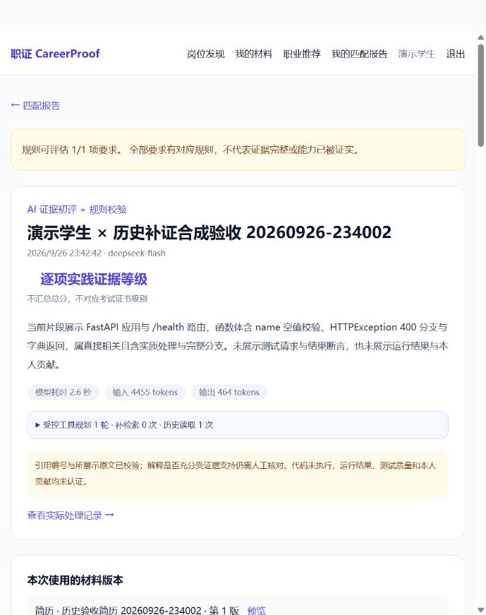

# 历史工具新版真实与浏览器联验

日期：2026-09-26。外部生成统一DeepSeek官方API、模型`deepseek-flash`；仅使用合成学生、简历及代码。重启项目自有服务后执行，数据库保存的提示版本已核对为`evidence-trust-v19-history-reference-isolation`。

## 两次真实完整报告

| 验证 | 目标报告 | 历史来源 | 当前结果 | 用量与模型耗时 |
| --- | --- | --- | --- | --- |
| 合成API上传及生成 | `7a237772-87c0-4240-bc02-ef2d1a1e5c61` | `d4970aa6-08cb-4b80-83ea-ec6d5f8e65df` | 空函数，AI 1级，无降级 | 输入4289、输出439、缓存命中1024，2938ms |
| 浏览器选择材料及授权生成 | `a25eaf92-6fe3-42ba-bff2-65b4a40ed7d1` | 上表目标报告 | 包含输入校验、异常与返回分支，AI 2级，无降级 | 输入4455、输出464、缓存命中2688，2595ms |

两份报告模型各自主读取一次冻结的本人同岗位历史；当前引用编号、行范围、原文与当前材料一致，网页生成报告额外核对整文件SHA256。反复API读取一致，企业读取均404。共输入8744、输出903，合计9647Tokens；缓存命中是输入的子集，不能再次相加，也不能仅凭Tokens核算实际账单。本轮未核对费用。

原记录：[API生成](../../../backend/evals/persisted-history-20260926-234002.json)、[网页生成与数据库版本核对](../../../backend/evals/browser-history-v19-20260926.json)。两份完整原始回答均保留，不修改评级制造结果。第二份模型仍将测试与实际运行记录视为缺口，评级为2；这不是预设应得3级的失败修正。

## 浏览器实际操作

演示学生从岗位发现筛选合成岗位，进入详情，选择对应简历及项目第1版，使用键盘分别勾选文字外发与历史参考授权，提交任务；任务显示处理完成，进入完整报告。展开与上一份报告对比，看到1/5→2/5及两条新增/不再展示证据；刷新后模型用量、历史读取与材料版本恢复。点击当前引用进入`#citation-R1-E1`，DOM核对目标存在、祖先详情已展开且原文可见。

这次选择的是已有第1版材料，不是上传新版本，不能把版本号倒退解读成学生能力成长。对比只陈述材料变化。第一份规则历史与AI报告之间还存在分析模式差异，同样不能仅将等级变化归因于材料。

390px视口下报告没有横向溢出，临时视口已恢复。以下为真实视口截图：

## 完成与未完成边界

完成：新版历史工具真实完整报告、结果保存、引用原文与版本核对、企业隔离，以及浏览器从**已有材料选择、授权到生成**的键盘流程。前一轮后端297项与Ruff通过；本轮只补真实结果和文档，没有改产品代码。

未完成：项目外独立人工语义复核、全鼠标流程、浏览器上传新材料到生成的完整流程。对比按钮鼠标自动化未激活，键盘成功，不能宣称鼠标验收通过。未伪造模型思考过程、未将真实运行成功当作所有语义难例通过。
