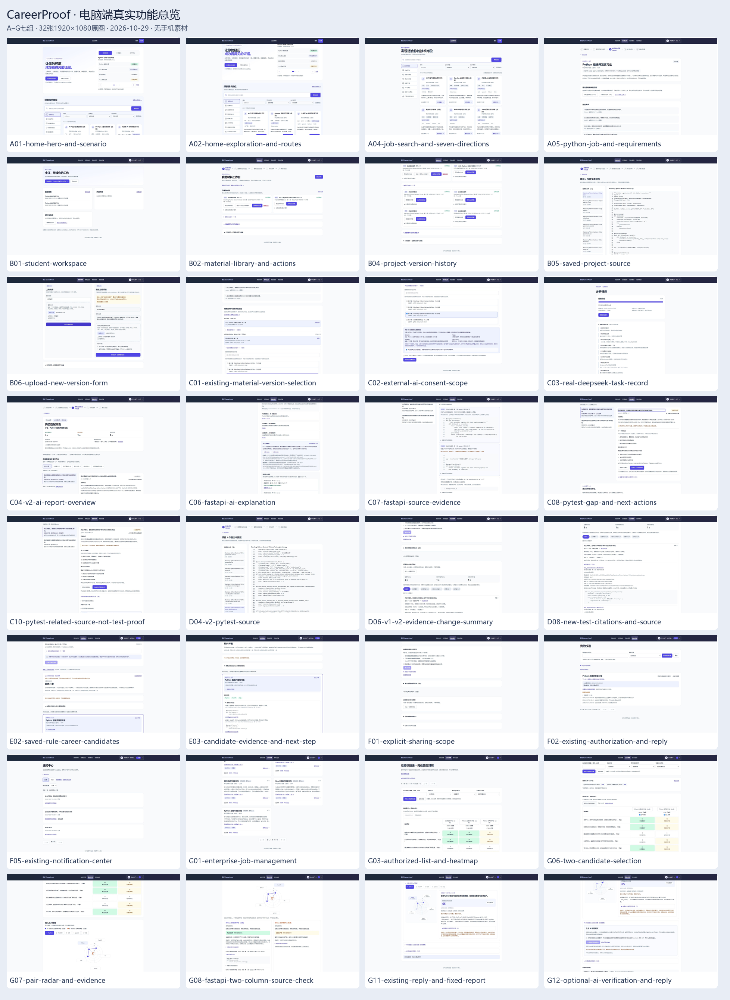

# CareerProof 电脑端功能截图 · 2026-10-29

本目录为比赛视频规划素材：**A–G七组，32张真实桌面PNG，均为1920×1080**。没有手机端素材。

- [逐张截图索引](SCREENSHOT_INDEX.md)：操作、展示重点、录制适用性和真实限制。
- [截图清单及SHA-256](SCREENSHOT_MANIFEST.json)。
- [原尺寸总览图](SCREENSHOT_OVERVIEW.png)：仅供快速找图；阅读细字请打开下方各张原图。

截图来自运行中的真实页面，不是设计稿。所有账号、简历和项目案例均为自编合成内容；模型解释来自已有真实DeepSeek报告。截图采集没有生成新报告、发送投递、企业回复或新增模型请求。

## 如何交给ChatGPT审阅

把本页及[逐张索引](SCREENSHOT_INDEX.md)的GitHub链接交给ChatGPT。索引每张图都有公开原图链接，可直接打开；不要只读缩略总览就推断代码细节。若当前工具无法读取GitHub图片，应明确说明并由用户上传原图，不得声称已看过。

请重点审阅：C03真实模型状态、C06/C07解释与代码、C08/C10测试缺口、D06/D08版本变化、F01授权范围、G03/G07/G08热力图与双人证据对照。目标是规划5–8分钟真实录屏，不开发、不录制视频、不生成新AI结果。

## 已确认的内容边界

- 小江V1为3项支持、2项待补；V2为4项支持、1项待补。V2报告固定项目第2版，材料库最新已到第5版；文件名中的V2不是材料库版本号。
- 小江没有既有职业规划、投递或通知。E02/E03、F02/F05使用另一位既有合成验收学生，不能混称为小江。
- E02/E03只展示历史规则候选，没有可用AI职业规划。G12企业核验入口存在，但没有已保存AI建议，不得录成已经生成。
- 当前补证路径是报告缺口→复制建议→外部改进→上传新版→主动重新分析，不要求新建独立补证任务。
- 雷达仅展示原报告材料支持程度，不是录用排名。上传测试代码和测试输出，不等于平台独立执行或本人贡献证明。
- 本机源码HEAD为 `86d50306d86a0cf0be615643bf0c9ae142f0df1d`；截图对应运行构建ID `czcR2mfJEQ8miBGygc_pp`。不将工作树HEAD自动冒充运行构建的来源提交。
- 使用真实浏览器1920×1080视口采集；专用物理显示器未能可靠识别，未绕过浏览器安全检查。

