# 逐张截图索引

[返回素材入口](README.md)。下面都是原尺寸1920×1080截图；没有账号凭据、私有配置或原始材料下载。

## 01. A01-home-hero-and-scenario

- 功能清单：A01
- 操作：访客打开首页第一屏
- 展示重点：产品名称、Hero与三场景合成预览
- 录制适用性：适合
- 发现/限制：无明显阻碍
- [打开原图](01-home-jobs/A01-home-hero-and-scenario.png) · [公开原图链接](https://raw.githubusercontent.com/hahaandxixi/careerproof/codex/video-screenshots-20261029/docs/demo-screenshots/20261029/01-home-jobs/A01-home-hero-and-scenario.png)

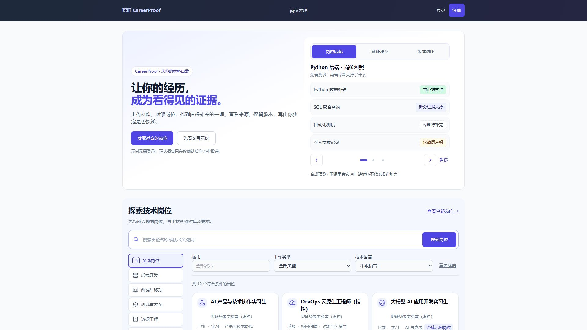

## 02. A02-home-exploration-and-routes

- 功能清单：A02, A03
- 操作：滚动到首页岗位探索区
- 展示重点：七大方向、搜索、岗位卡片和紧凑角色入口
- 录制适用性：适合
- 发现/限制：无明显阻碍
- [打开原图](01-home-jobs/A02-home-exploration-and-routes.png) · [公开原图链接](https://raw.githubusercontent.com/hahaandxixi/careerproof/codex/video-screenshots-20261029/docs/demo-screenshots/20261029/01-home-jobs/A02-home-exploration-and-routes.png)

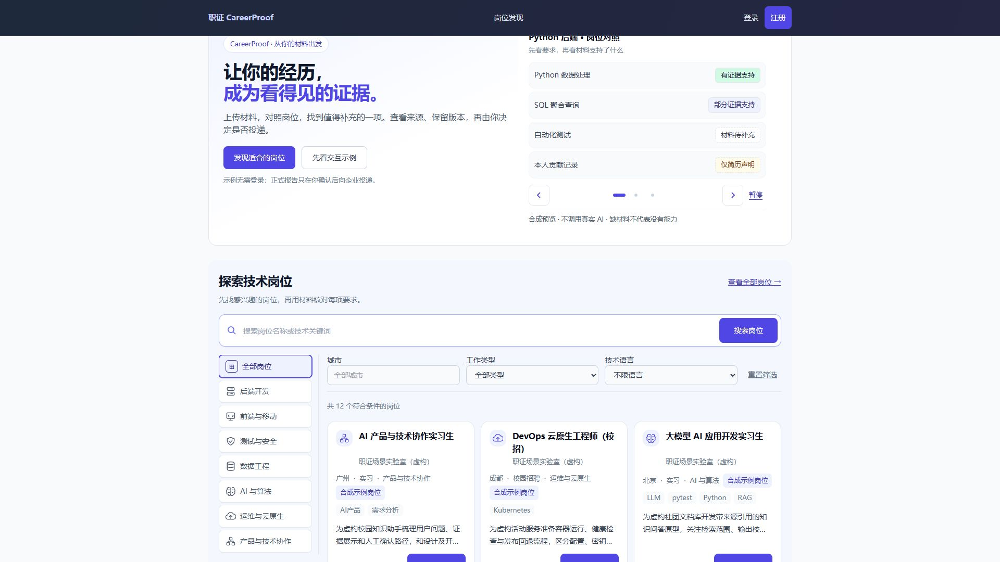

## 03. A04-job-search-and-seven-directions

- 功能清单：A03, A04
- 操作：打开岗位发现
- 展示重点：七方向、二级标签、服务端筛选和岗位结果
- 录制适用性：适合
- 发现/限制：P1：完整岗位列表仍包含历史Mock测试岗；录制时选择明确的Python后端案例，不把旧测试岗称为真实招聘。
- [打开原图](01-home-jobs/A04-job-search-and-seven-directions.png) · [公开原图链接](https://raw.githubusercontent.com/hahaandxixi/careerproof/codex/video-screenshots-20261029/docs/demo-screenshots/20261029/01-home-jobs/A04-job-search-and-seven-directions.png)

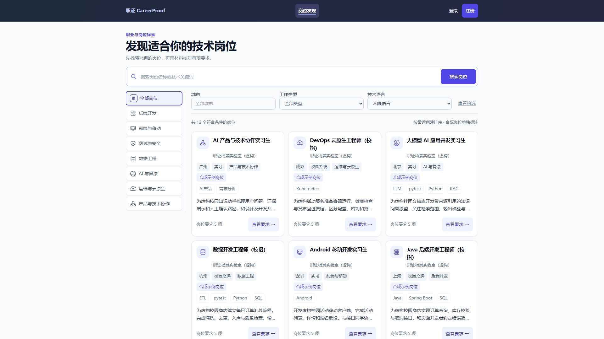

## 04. A05-python-job-and-requirements

- 功能清单：A05, G02
- 操作：打开Python岗位详情
- 展示重点：Python岗位实际要求；该图为学生视角，企业归属见G01，不冒充企业详情截图。
- 录制适用性：适合
- 发现/限制：无明显阻碍
- [打开原图](01-home-jobs/A05-python-job-and-requirements.png) · [公开原图链接](https://raw.githubusercontent.com/hahaandxixi/careerproof/codex/video-screenshots-20261029/docs/demo-screenshots/20261029/01-home-jobs/A05-python-job-and-requirements.png)

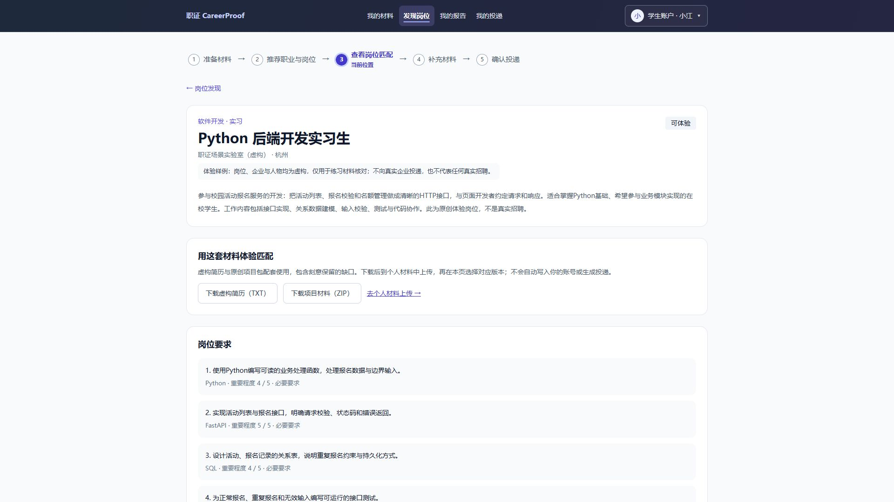

## 05. B01-student-workspace

- 功能清单：B01
- 操作：登录小江后打开首页
- 展示重点：最近报告、材料和岗位入口
- 录制适用性：适合
- 发现/限制：无明显阻碍
- [打开原图](02-student-materials/B01-student-workspace.png) · [公开原图链接](https://raw.githubusercontent.com/hahaandxixi/careerproof/codex/video-screenshots-20261029/docs/demo-screenshots/20261029/02-student-materials/B01-student-workspace.png)

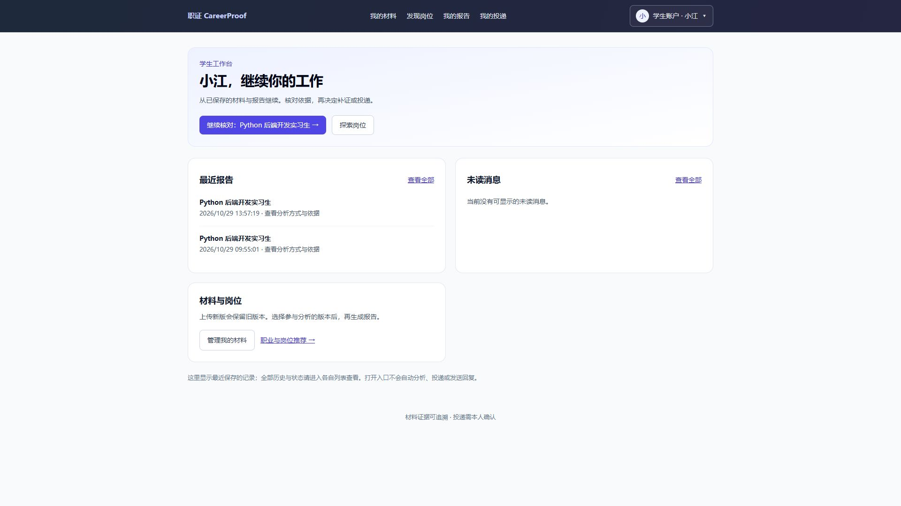

## 06. B02-material-library-and-actions

- 功能清单：B02, B03, B07
- 操作：我的材料 → 已保存材料
- 展示重点：简历、项目、最新版本与删除入口（未执行删除）
- 录制适用性：适合，需说明固定版本
- 发现/限制：录制注意：项目库最新为第5版，现有AI报告固定引用第2版；不是页面错误。
- [打开原图](02-student-materials/B02-material-library-and-actions.png) · [公开原图链接](https://raw.githubusercontent.com/hahaandxixi/careerproof/codex/video-screenshots-20261029/docs/demo-screenshots/20261029/02-student-materials/B02-material-library-and-actions.png)

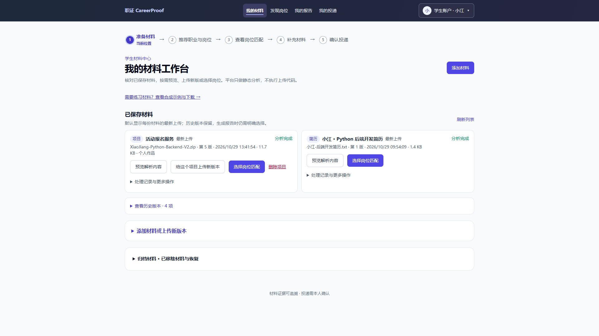

## 07. B04-project-version-history

- 功能清单：B04
- 操作：展开历史版本
- 展示重点：原项目第1版与第2版，以及后续重复上传的独立版本
- 录制适用性：适合，需选清版本
- 发现/限制：同名V2包还被上传为第3—5版；录制固定报告应使用第2版。
- [打开原图](02-student-materials/B04-project-version-history.png) · [公开原图链接](https://raw.githubusercontent.com/hahaandxixi/careerproof/codex/video-screenshots-20261029/docs/demo-screenshots/20261029/02-student-materials/B04-project-version-history.png)

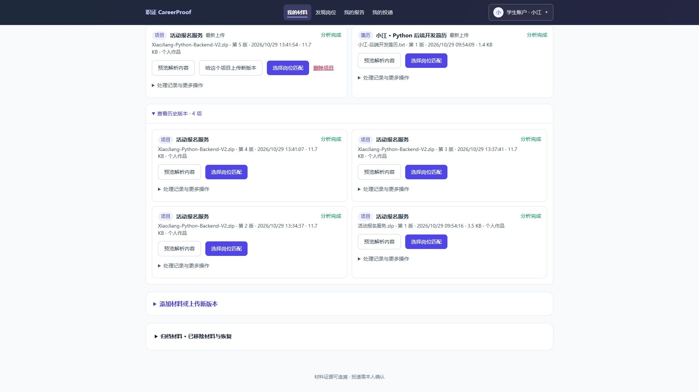

## 08. B05-saved-project-source

- 功能清单：B05
- 操作：打开报告所用项目第2版 → app.py
- 展示重点：真实保存的多文件列表、源码及行号
- 录制适用性：适合
- 发现/限制：无明显阻碍
- [打开原图](02-student-materials/B05-saved-project-source.png) · [公开原图链接](https://raw.githubusercontent.com/hahaandxixi/careerproof/codex/video-screenshots-20261029/docs/demo-screenshots/20261029/02-student-materials/B05-saved-project-source.png)

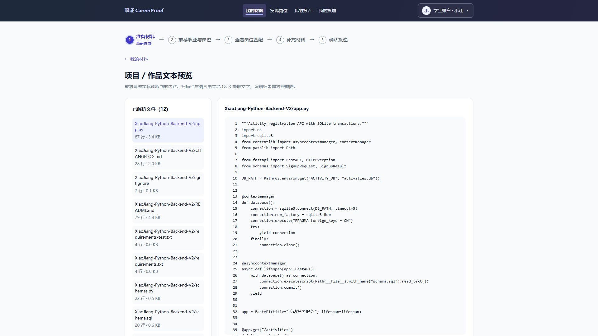

## 09. B06-upload-new-version-form

- 功能清单：B06, D02
- 操作：项目卡片 → 给这个项目上传新版本（不选文件、不提交）
- 展示重点：上传目标属于原项目；简历与项目分开准备
- 录制适用性：适合，需旁白说明尚未提交
- 发现/限制：P2：尚未提交时提示“正在上传到”，容易被理解为已开始上传。
- [打开原图](02-student-materials/B06-upload-new-version-form.png) · [公开原图链接](https://raw.githubusercontent.com/hahaandxixi/careerproof/codex/video-screenshots-20261029/docs/demo-screenshots/20261029/02-student-materials/B06-upload-new-version-form.png)

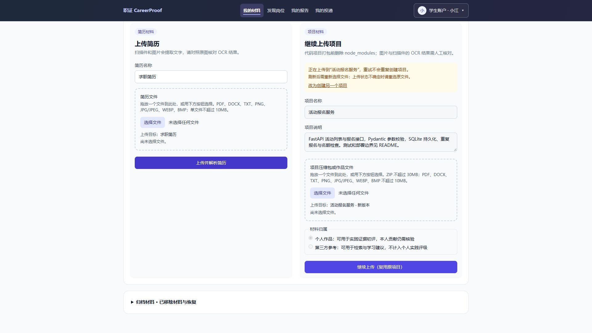

## 10. C01-existing-material-version-selection

- 功能清单：C01
- 操作：选择已有简历V1和项目第2版，不生成报告
- 展示重点：材料版本明确选择、上传新版不自动替换报告
- 录制适用性：适合
- 发现/限制：无明显阻碍
- [打开原图](03-real-ai-report/C01-existing-material-version-selection.png) · [公开原图链接](https://raw.githubusercontent.com/hahaandxixi/careerproof/codex/video-screenshots-20261029/docs/demo-screenshots/20261029/03-real-ai-report/C01-existing-material-version-selection.png)

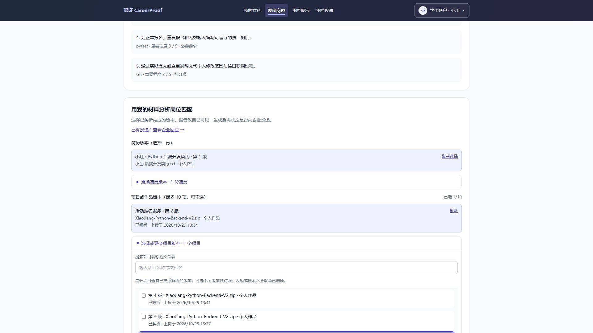

## 11. C02-external-ai-consent-scope

- 功能清单：C02
- 操作：展示外部AI发送说明，仅勾选页面控件不提交
- 展示重点：必要片段、脱敏、历史参考另行选择
- 录制适用性：适合
- 发现/限制：无明显阻碍
- [打开原图](03-real-ai-report/C02-external-ai-consent-scope.png) · [公开原图链接](https://raw.githubusercontent.com/hahaandxixi/careerproof/codex/video-screenshots-20261029/docs/demo-screenshots/20261029/03-real-ai-report/C02-external-ai-consent-scope.png)

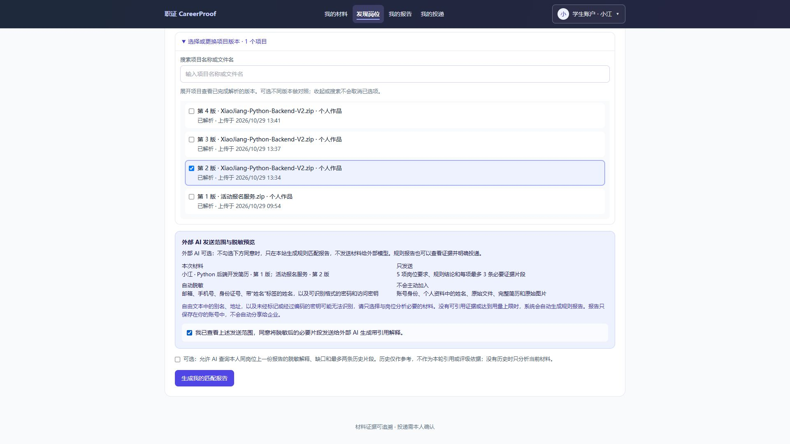

## 12. C03-real-deepseek-task-record

- 功能清单：C03
- 操作：打开已完成任务并展开实际处理记录
- 展示重点：deepseek-flash、5项解释、真实tokens与引用校验
- 录制适用性：适合，需解释阶段含义
- 发现/限制：P1：本地语义检索阶段写“保留词法检索与规则报告”，容易与最终DeepSeek成功模式混淆；模型阶段实际成功。
- [打开原图](03-real-ai-report/C03-real-deepseek-task-record.png) · [公开原图链接](https://raw.githubusercontent.com/hahaandxixi/careerproof/codex/video-screenshots-20261029/docs/demo-screenshots/20261029/03-real-ai-report/C03-real-deepseek-task-record.png)

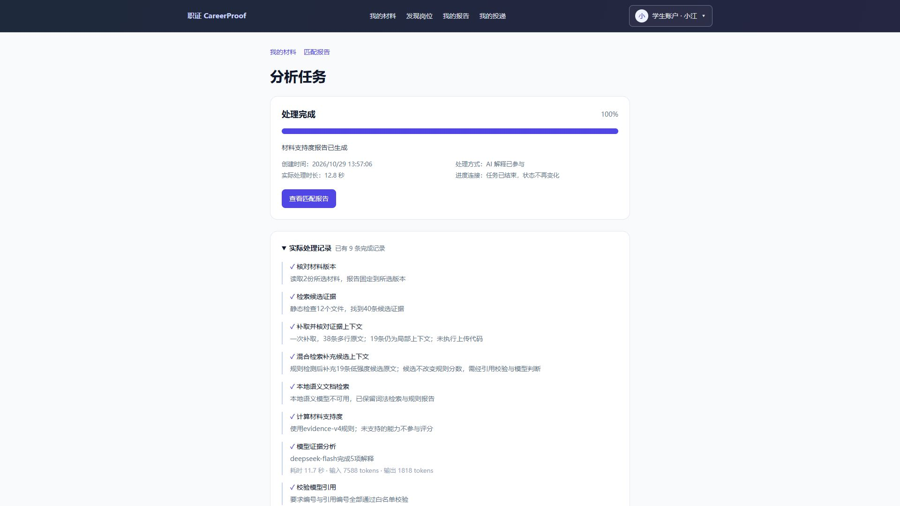

## 13. C04-v2-ai-report-overview

- 功能清单：C04, D05, D09
- 操作：打开已保存V2报告
- 展示重点：小江、Python岗位、AI模式、4项支持与1项待补
- 录制适用性：适合
- 发现/限制：无明显阻碍
- [打开原图](03-real-ai-report/C04-v2-ai-report-overview.png) · [公开原图链接](https://raw.githubusercontent.com/hahaandxixi/careerproof/codex/video-screenshots-20261029/docs/demo-screenshots/20261029/03-real-ai-report/C04-v2-ai-report-overview.png)

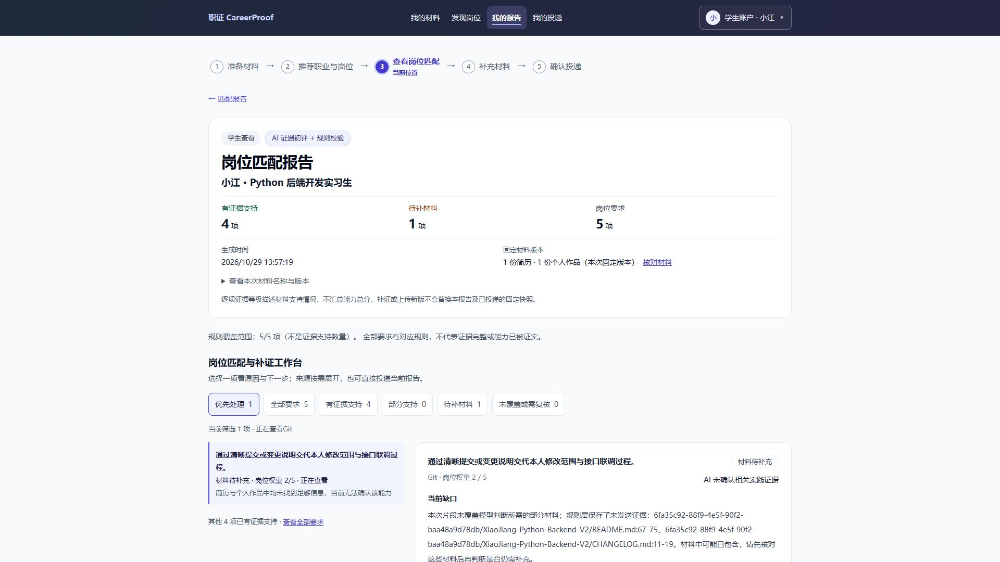

## 14. C06-fastapi-ai-explanation

- 功能清单：C06
- 操作：展开判据与AI证据解释
- 展示重点：DeepSeek对路由、查询、剩余名额的具体解释
- 录制适用性：适合，录制前先展开
- 发现/限制：P1：AI解释埋在多层展开区，且缺口文字包含较长内部路径。
- [打开原图](03-real-ai-report/C06-fastapi-ai-explanation.png) · [公开原图链接](https://raw.githubusercontent.com/hahaandxixi/careerproof/codex/video-screenshots-20261029/docs/demo-screenshots/20261029/03-real-ai-report/C06-fastapi-ai-explanation.png)

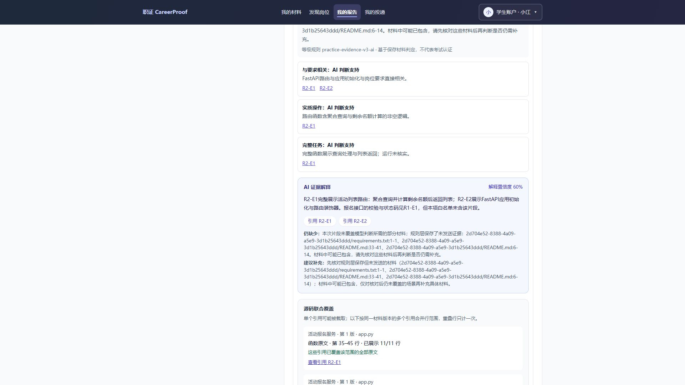

## 15. C07-fastapi-source-evidence

- 功能清单：C07, C05
- 操作：点击AI解释的引用R2-E1
- 展示重点：app.py第35–45行与完整活动列表函数
- 录制适用性：适合
- 发现/限制：无明显阻碍
- [打开原图](03-real-ai-report/C07-fastapi-source-evidence.png) · [公开原图链接](https://raw.githubusercontent.com/hahaandxixi/careerproof/codex/video-screenshots-20261029/docs/demo-screenshots/20261029/03-real-ai-report/C07-fastapi-source-evidence.png)

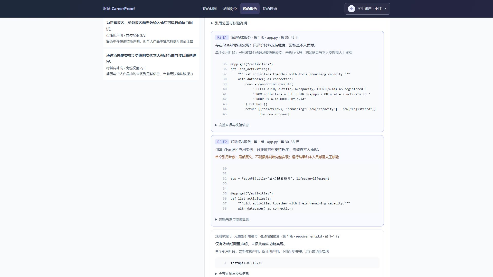

## 16. C08-pytest-gap-and-next-actions

- 功能清单：C08, C09, D01, D02, E05
- 操作：选择原版pytest要求
- 展示重点：真实测试证据缺口、三条行动与上传新版入口
- 录制适用性：适合，保留真实状态
- 发现/限制：P1：缺口首段仍有长UUID，且“暂无已保存计划”容易分散注意。
- [打开原图](03-real-ai-report/C08-pytest-gap-and-next-actions.png) · [公开原图链接](https://raw.githubusercontent.com/hahaandxixi/careerproof/codex/video-screenshots-20261029/docs/demo-screenshots/20261029/03-real-ai-report/C08-pytest-gap-and-next-actions.png)

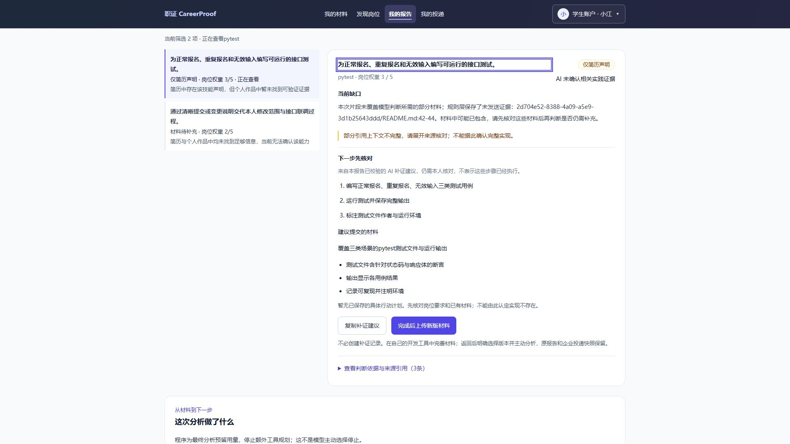

## 17. C10-pytest-related-source-not-test-proof

- 功能清单：C10
- 操作：查看pytest关联README与报名实现
- 展示重点：相关实现不等于测试已执行
- 录制适用性：适合
- 发现/限制：无明显阻碍
- [打开原图](03-real-ai-report/C10-pytest-related-source-not-test-proof.png) · [公开原图链接](https://raw.githubusercontent.com/hahaandxixi/careerproof/codex/video-screenshots-20261029/docs/demo-screenshots/20261029/03-real-ai-report/C10-pytest-related-source-not-test-proof.png)

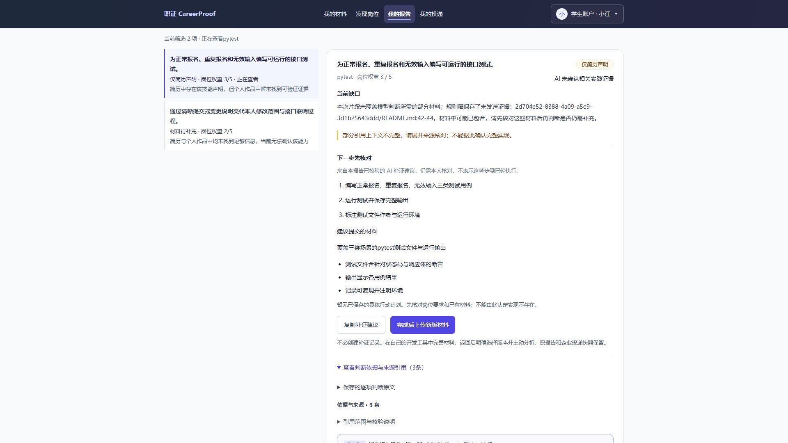

## 18. D04-v2-pytest-source

- 功能清单：D04
- 操作：项目第2版 → tests/test_registration.py
- 展示重点：新增实际测试函数、请求、断言；不将代码存在当作测试通过
- 录制适用性：适合
- 发现/限制：无明显阻碍
- [打开原图](04-evidence-growth/D04-v2-pytest-source.png) · [公开原图链接](https://raw.githubusercontent.com/hahaandxixi/careerproof/codex/video-screenshots-20261029/docs/demo-screenshots/20261029/04-evidence-growth/D04-v2-pytest-source.png)

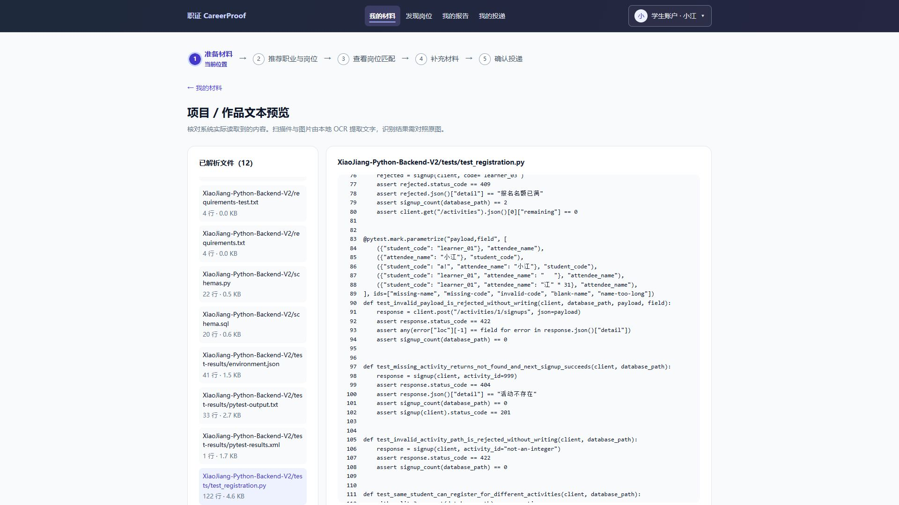

## 19. D06-v1-v2-evidence-change-summary

- 功能清单：D06, D07
- 操作：读取与上一份报告对比
- 展示重点：5项证据变化、1项状态变化、pytest从声明到支持
- 录制适用性：适合
- 发现/限制：无明显阻碍
- [打开原图](04-evidence-growth/D06-v1-v2-evidence-change-summary.png) · [公开原图链接](https://raw.githubusercontent.com/hahaandxixi/careerproof/codex/video-screenshots-20261029/docs/demo-screenshots/20261029/04-evidence-growth/D06-v1-v2-evidence-change-summary.png)

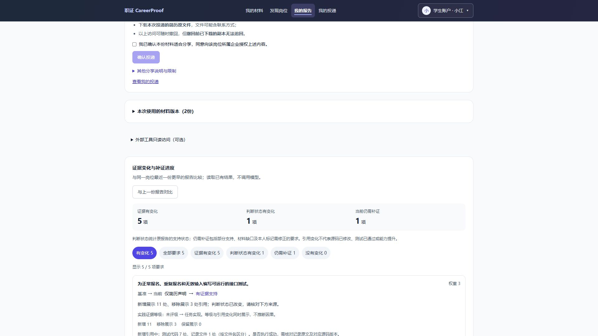

## 20. D08-new-test-citations-and-source

- 功能清单：D08
- 操作：展开pytest新增引用与源码
- 展示重点：新增测试引用、记录文件与原文核验
- 录制适用性：适合
- 发现/限制：无明显阻碍
- [打开原图](04-evidence-growth/D08-new-test-citations-and-source.png) · [公开原图链接](https://raw.githubusercontent.com/hahaandxixi/careerproof/codex/video-screenshots-20261029/docs/demo-screenshots/20261029/04-evidence-growth/D08-new-test-citations-and-source.png)

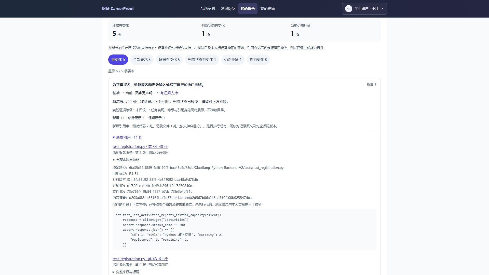

## 21. E02-saved-rule-career-candidates

- 功能清单：E01, E02, E04
- 操作：只读取既有验收学生的上次规划
- 展示重点：真实保存的三岗位候选与规则降级说明，非小江
- 录制适用性：适合展示规则候选，需说明模式
- 发现/限制：历史结果没有可用AI规划，不能录成真实DeepSeek职业规划。
- [打开原图](05-career-planning/E02-saved-rule-career-candidates.png) · [公开原图链接](https://raw.githubusercontent.com/hahaandxixi/careerproof/codex/video-screenshots-20261029/docs/demo-screenshots/20261029/05-career-planning/E02-saved-rule-career-candidates.png)

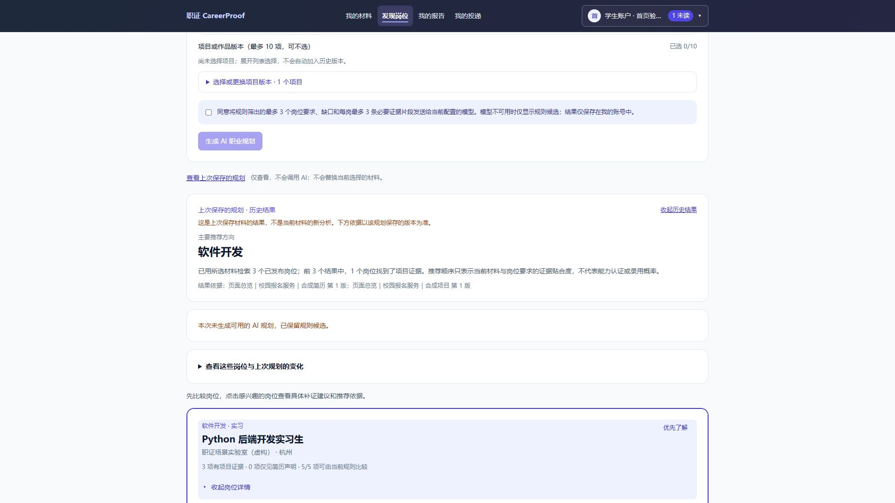

## 22. E03-candidate-evidence-and-next-step

- 功能清单：E03
- 操作：展开已有候选岗位的推荐依据
- 展示重点：规则证据依据、缺口与进入完整报告的入口
- 录制适用性：适合说明推荐依据
- 发现/限制：这是历史规则推荐，不是新的AI规划。
- [打开原图](05-career-planning/E03-candidate-evidence-and-next-step.png) · [公开原图链接](https://raw.githubusercontent.com/hahaandxixi/careerproof/codex/video-screenshots-20261029/docs/demo-screenshots/20261029/05-career-planning/E03-candidate-evidence-and-next-step.png)

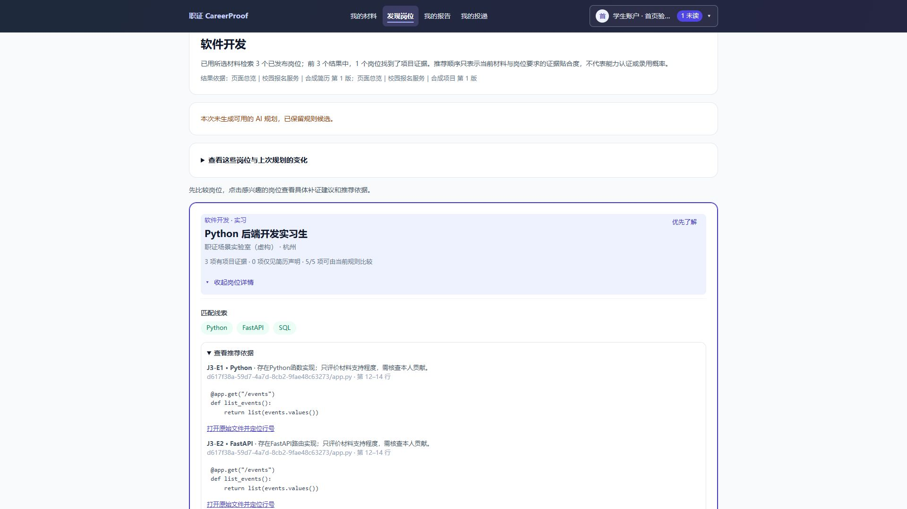

## 23. F01-explicit-sharing-scope

- 功能清单：F01, F06
- 操作：查看报告投递授权区域，不勾选不投递
- 展示重点：固定报告与简历授权范围、撤回限制和人工确认
- 录制适用性：适合
- 发现/限制：无明显阻碍
- [打开原图](06-applications-notifications/F01-explicit-sharing-scope.png) · [公开原图链接](https://raw.githubusercontent.com/hahaandxixi/careerproof/codex/video-screenshots-20261029/docs/demo-screenshots/20261029/06-applications-notifications/F01-explicit-sharing-scope.png)

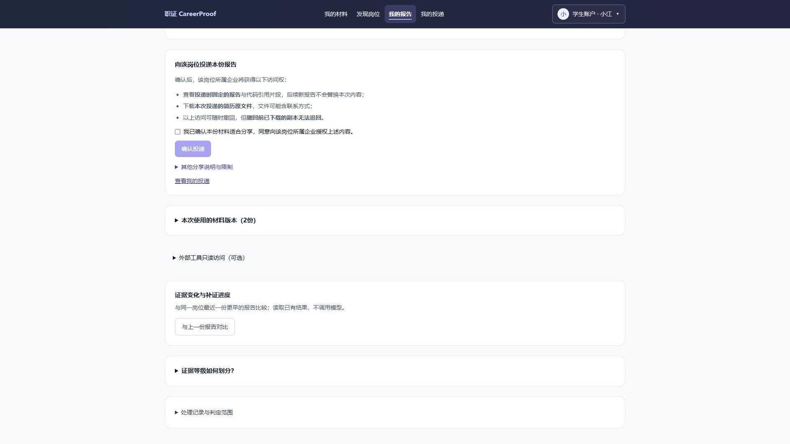

## 24. F02-existing-authorization-and-reply

- 功能清单：F02, F03, F04, F06
- 操作：读取已有合成验收学生的投递时间线，不撤回
- 展示重点：已授权固定报告、企业已有回复、撤回入口；非小江账号
- 录制适用性：适合企业授权链路，需说明账号
- 发现/限制：与小江是不同合成学生，录制时须明确切换案例。
- [打开原图](06-applications-notifications/F02-existing-authorization-and-reply.png) · [公开原图链接](https://raw.githubusercontent.com/hahaandxixi/careerproof/codex/video-screenshots-20261029/docs/demo-screenshots/20261029/06-applications-notifications/F02-existing-authorization-and-reply.png)

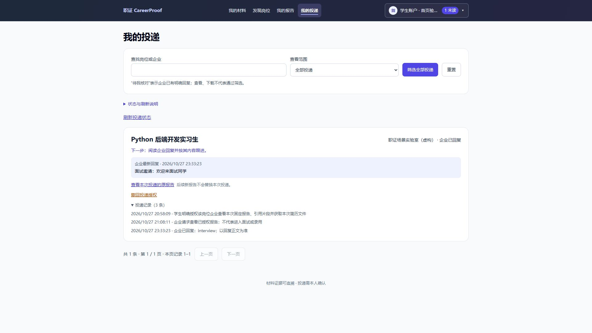

## 25. F05-existing-notification-center

- 功能清单：F05
- 操作：只查看通知列表，不标记未读项
- 展示重点：既有提交、查看、回复事件及状态边界
- 录制适用性：适合
- 发现/限制：无明显阻碍
- [打开原图](06-applications-notifications/F05-existing-notification-center.png) · [公开原图链接](https://raw.githubusercontent.com/hahaandxixi/careerproof/codex/video-screenshots-20261029/docs/demo-screenshots/20261029/06-applications-notifications/F05-existing-notification-center.png)

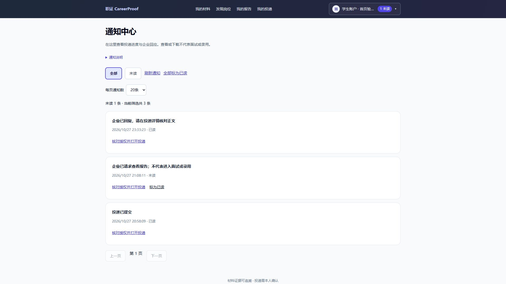

## 26. G01-enterprise-job-management

- 功能清单：G01
- 操作：企业进入我的岗位
- 展示重点：现有岗位、真实授权投递数量及管理入口
- 录制适用性：适合
- 发现/限制：无明显阻碍
- [打开原图](07-enterprise-comparison/G01-enterprise-job-management.png) · [公开原图链接](https://raw.githubusercontent.com/hahaandxixi/careerproof/codex/video-screenshots-20261029/docs/demo-screenshots/20261029/07-enterprise-comparison/G01-enterprise-job-management.png)

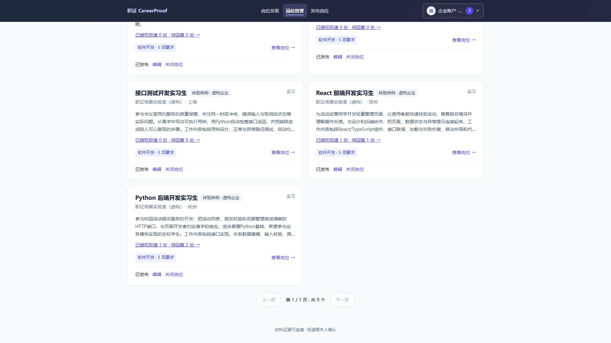

## 27. G03-authorized-list-and-heatmap

- 功能清单：G03, G04
- 操作：进入Python岗位已有授权列表
- 展示重点：三份既有授权、服务端筛选与要求热力图
- 录制适用性：适合
- 发现/限制：无明显阻碍
- [打开原图](07-enterprise-comparison/G03-authorized-list-and-heatmap.png) · [公开原图链接](https://raw.githubusercontent.com/hahaandxixi/careerproof/codex/video-screenshots-20261029/docs/demo-screenshots/20261029/07-enterprise-comparison/G03-authorized-list-and-heatmap.png)

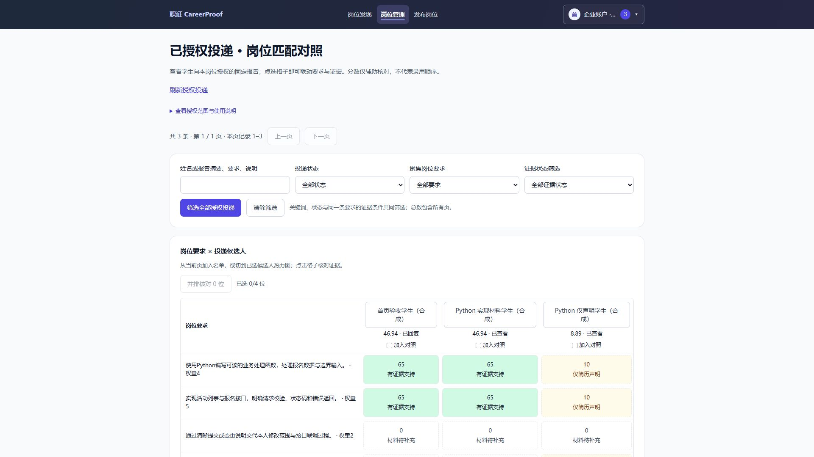

## 28. G06-two-candidate-selection

- 功能清单：G06
- 操作：将已存在的实现与声明学生加入对照
- 展示重点：2/4对照名单、可移除、仅显示已选热力图
- 录制适用性：适合
- 发现/限制：无明显阻碍
- [打开原图](07-enterprise-comparison/G06-two-candidate-selection.png) · [公开原图链接](https://raw.githubusercontent.com/hahaandxixi/careerproof/codex/video-screenshots-20261029/docs/demo-screenshots/20261029/07-enterprise-comparison/G06-two-candidate-selection.png)

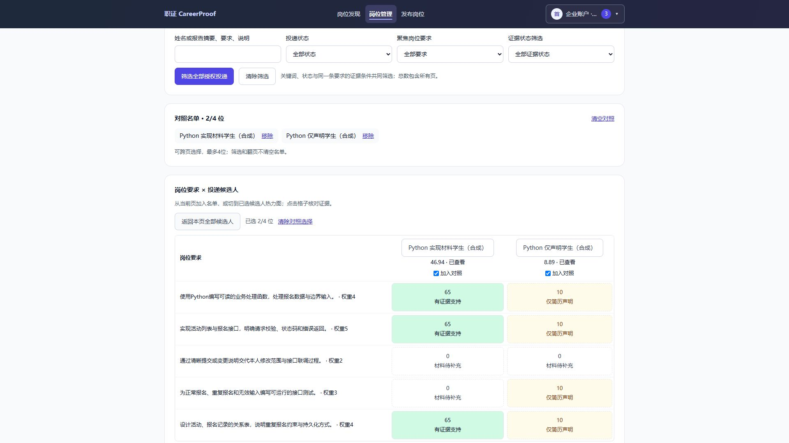

## 29. G07-pair-radar-and-evidence

- 功能清单：G07, G08, G10
- 操作：打开双人深入核对
- 展示重点：同轴雷达、身份图例、固定报告与双列证据
- 录制适用性：适合
- 发现/限制：无明显阻碍
- [打开原图](07-enterprise-comparison/G07-pair-radar-and-evidence.png) · [公开原图链接](https://raw.githubusercontent.com/hahaandxixi/careerproof/codex/video-screenshots-20261029/docs/demo-screenshots/20261029/07-enterprise-comparison/G07-pair-radar-and-evidence.png)

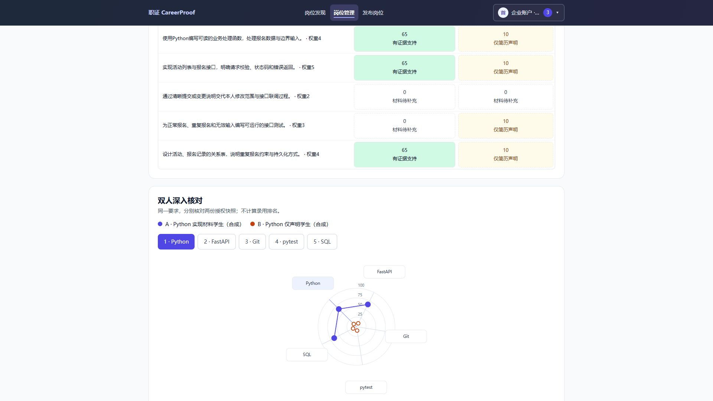

## 30. G08-fastapi-two-column-source-check

- 功能清单：G05, G08, G09
- 操作：选择FastAPI并展开已有源码
- 展示重点：左侧源码支持，右侧仅简历声明且无对应引用
- 录制适用性：适合
- 发现/限制：无明显阻碍
- [打开原图](07-enterprise-comparison/G08-fastapi-two-column-source-check.png) · [公开原图链接](https://raw.githubusercontent.com/hahaandxixi/careerproof/codex/video-screenshots-20261029/docs/demo-screenshots/20261029/07-enterprise-comparison/G08-fastapi-two-column-source-check.png)

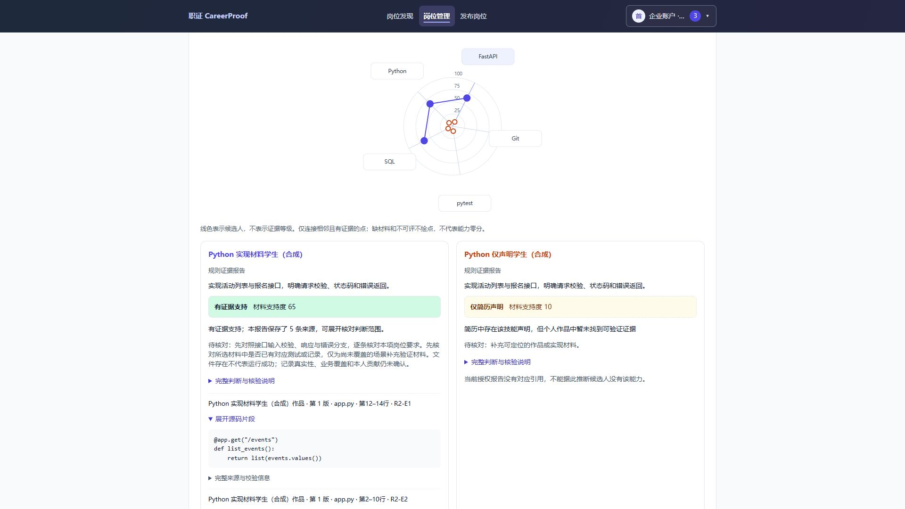

## 31. G11-existing-reply-and-fixed-report

- 功能清单：G10, G11
- 操作：查看已回复的历史授权投递
- 展示重点：已有人工回复与投递时固定报告，不发送新消息
- 录制适用性：适合
- 发现/限制：无明显阻碍
- [打开原图](07-enterprise-comparison/G11-existing-reply-and-fixed-report.png) · [公开原图链接](https://raw.githubusercontent.com/hahaandxixi/careerproof/codex/video-screenshots-20261029/docs/demo-screenshots/20261029/07-enterprise-comparison/G11-existing-reply-and-fixed-report.png)

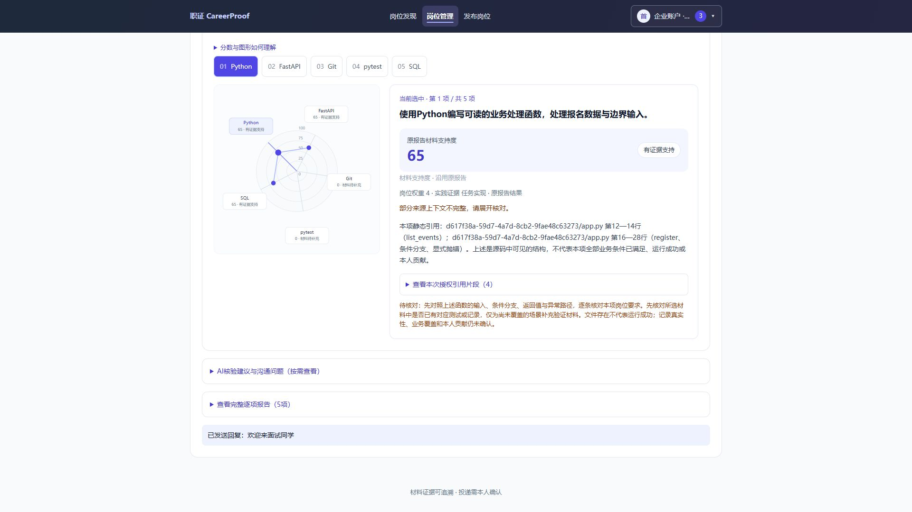

## 32. G12-optional-ai-verification-and-reply

- 功能清单：G11, G12
- 操作：展开企业核验面板并只读取已保存建议
- 展示重点：可选AI入口、外发确认和人工发送回复
- 录制适用性：适合展示入口与人工确认边界
- 发现/限制：当前投递尚无已保存企业AI核验建议；不能录成已生成结果。
- [打开原图](07-enterprise-comparison/G12-optional-ai-verification-and-reply.png) · [公开原图链接](https://raw.githubusercontent.com/hahaandxixi/careerproof/codex/video-screenshots-20261029/docs/demo-screenshots/20261029/07-enterprise-comparison/G12-optional-ai-verification-and-reply.png)

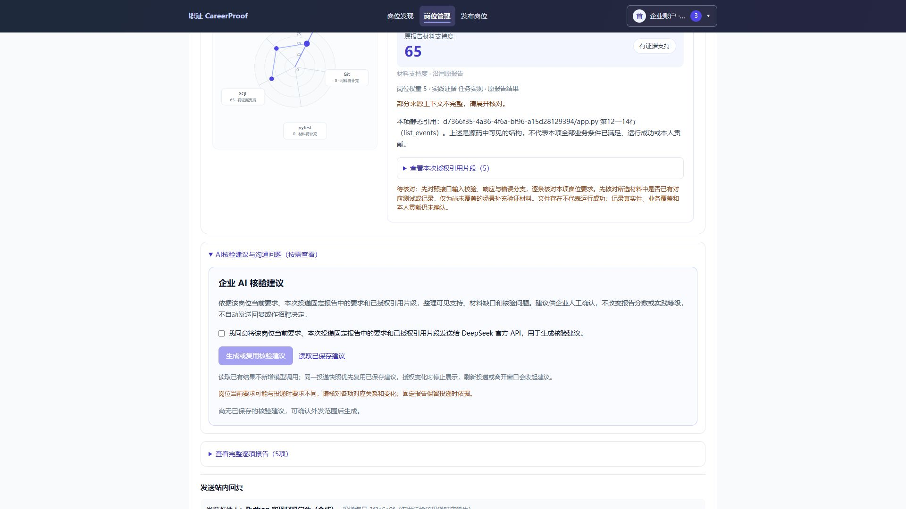

## 缺项与录制注意

- D03没有单独补证任务素材：当前产品不强制创建任务，C08/B06为真实替代入口。
- G02不单独重复截图：A05为岗位要求（学生视角），G01为所属企业管理，不能把A05说成企业截图。
- P1：AI解释需多层展开，部分缺口含长UUID/路径；任务记录中的本地语义检索降级措辞容易与最终DeepSeek成功混淆，讲解时应区分阶段。
- P1：完整岗位库仍有旧Mock测试岗，录制时选准目标Python岗位，不能称为真实企业招聘。
- P2：未提交上传表单有“正在上传到…”措辞。以上只记录，不在本轮改代码。
- 本次打开页面没有遇到阻断主要展示的P0，不代表新上传、模型调用、投递、撤回、发送回复等写流程都重新验收通过。
