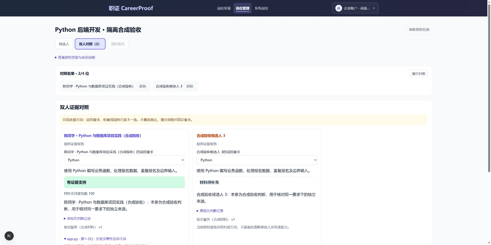
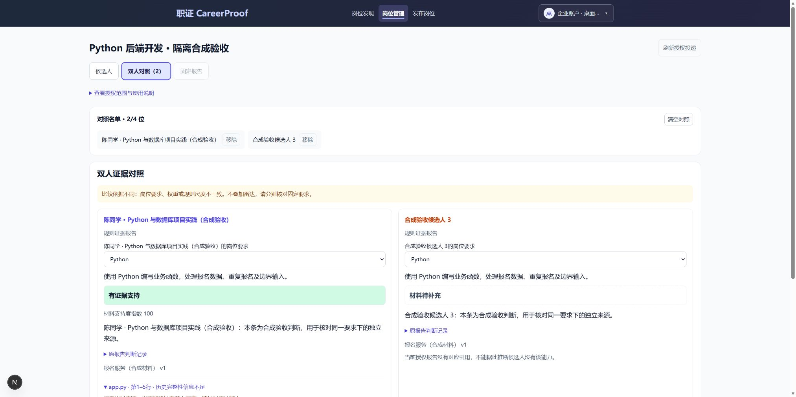
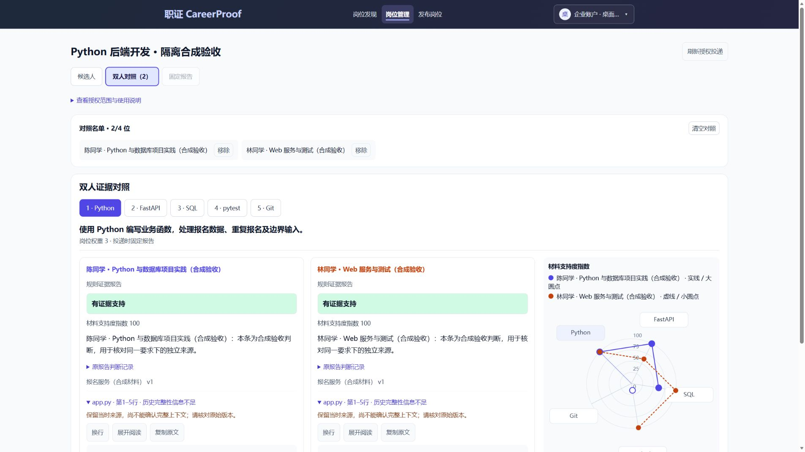
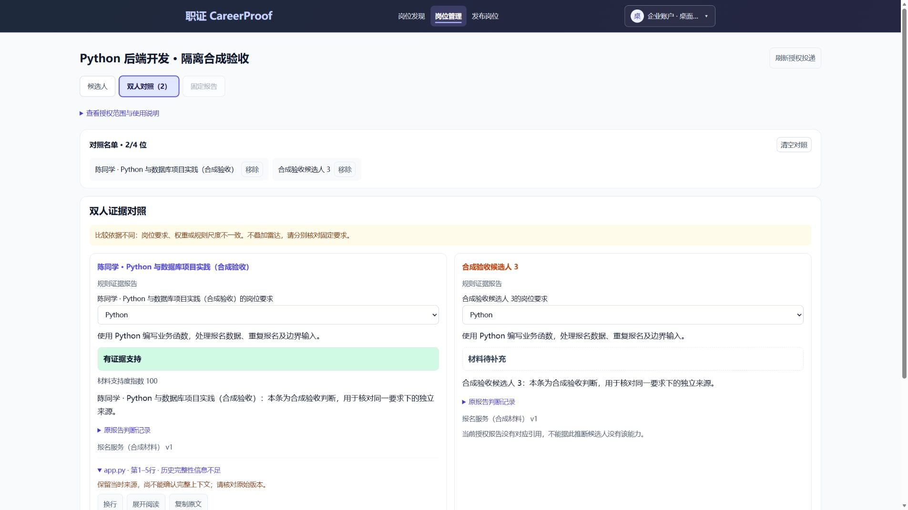

# 最新企业/报告 UI：独立审查入口

2026-11-01。整合范围为main `7b956c7` 后的相关本地成果及本次三批修复；不包含归档草稿PR #2/#3/#4、他人工作区修改、材料或数据库。最终功能源码 `fb34cba`，本页后续提交只补审查材料。评分、授权、历史报告、投递快照、AI原文及图表颜色含义保持。未调用模型、未推送真实业务操作。

## 三批修改

| 批次/提交 | 最终行为 | 本地验证 |
| --- | --- | --- |
| `7bd9cd4` 计量 | 公开示例表格与雷达共同展示指数，65→100、40→61.5、10→15.4；缺材料只显示状态，不显示0。原始分值详情保留API数值精度，如38.27不改成38.3 | 22项相关测试通过，包含实际HeatmapDemo父组件、0/null/gap/unsupported/claimed/未知口径、原数据不变 |
| `d821970` 来源阅读（客户端声明修正于`fb34cba`） | 全部来源保留在紧凑目录，当前引用单独阅读；其他原文仍挂载但隐藏。AI引用、重复片段、书签及前进/后退切换正确来源；保留版本、行号、上下文/权限限制、换行/展开/复制 | 28项报告/阅读回归通过，含12来源、同名文件不同版本、精确锚点与重复点击；最终构建验证客户端边界 |
| `fb34cba` 图表与回退 | 单人图表父列至少460px，图表最大440px，标签/刻度字号提升，长名截短但完整名称仍可访问；没有可叠加图表时，双列证据不再预留360/420px空列 | 44项相关图表/对照回归通过；隔离页面实际复现空列并在dev热更新后确认消失 |

整合定向运行 **86通过、0失败、0跳过**，不与分批重叠数量相加。目标ESLint、类型及两份独立生产构建通过。命令：

```powershell
cd jianli
node --experimental-strip-types --test tests/support-index.test.mjs tests/skill-radar.test.mjs tests/skill-radar-render.test.mjs tests/history-enterprise.test.mjs tests/evidence-display.test.mjs tests/application-comparison.test.mjs tests/application-board-visibility.test.mjs tests/heatmap-demo.test.mjs tests/report-reader.test.mjs tests/desktop-reading.test.mjs
```

构建 `fzu-WABM9r2QL-KGbfD4J` / `.next-followup-20261101` 对应原API8140；同源合成验收构建 `taa37JHNyx5_K6Qgg9QFe` / `.next-followup-mock-20261101` 对应纯mock8161。生产构建通过，保留原VisualEvidencePanel的img优化warning。`next-env.d.ts`、`tsconfig.json`已恢复到本轮开工字节，不进入本次提交。

## 必须保留的解释边界

- 展示指数=`raw/已确认cap*100`，几何使用未舍入比例，原值保留。evidence-v3/v4的cap65来自matcher源码及`c458812`版本差异；未知历史规则不凭最大值推定上限。公开示例使用显式示例尺度元数据，不给历史报告默认套用。
- 整图统一尺度，不随当前要求切换分母；双人仍核对岗位、要求、权重、规则版本及固定依据完整性。缺项、缺材料、不可评、声明、真实可评零和异常值分开处理，不clamp越界值成100。复杂要求可能另外封顶30，指数不是能力完成率或录用排名。
- 紧凑来源没有删去任何源码、引用或版本，也不把“未送模型”“未授权”“上下文不足”混称为缺材料。授权失效后的报告恢复保护沿用现有实现。

## 最近一并集成的成果

此前相关批次还包括：全站操作入口样式统一（保留正文/引用链接）、桌面源码换行与键盘阅读、报告核对写→读串行和未知写结果的只读恢复、授权投递使用所属User.id作稳定candidateId、学生与企业回复类型/事件时间统一、矩阵缺项与不可评区分。这些边界、定向结果见[三批状态/身份修复](20261030-simplicity-batches/three-batches-20261031.md)、[桌面阅读](20261031-desktop-refinement.md)、[指数依据](20261101-support-index.md)。旧报告及原业务数据不迁移、不改写。

## 实拍证据与尚未验收

Edge扩展本轮正常读取URL和操作页面；旧“所有浏览器都不可用”的结论不适用。开工3140确认为 `e2e043d` / `ayj9grXn757U2gqBdLjto`。真实小江报告Python项的12处来源、示例旧表格与雷达混用计量及317px图表已在该构建复现，真实材料截图仅留本机，不上传。

本次双人回退截图来自独立合成接口（没有数据库、AI或真实候选人），不是实际招聘结果。浏览器设置视口1920×1080，截图实际像素分别2025×1012；如窗口/工具输出与视口不同，以原PNG尺寸为准，没有缩放或伪称精确1920截图。改前：单子区仍占1086.67px并空留420px；dev修复后：单子区占满1526.67px，两列证据恢复可用宽度。




随后用户手动启动了3141/8161，再按修正后的同一入口补齐3142；自动审批拒绝的那次命令没有执行。手动脚本最初将描述文本误当进程命令做健康校验，造成3141虽已启动但没有继续3142；已修正为实际命令子串、校验PID/时间及构建后复用，不结束任何现有服务。原3140/8140始终未切换。

**最终生产构建已实测：** 3141使用`fzu-WABM9r2QL-KGbfD4J`，示例表格/雷达均显示100/61.5/15.4，缺材料无零值；单人SVG实测440px（改前317.125px），最小刻度/状态字号14画布单位。SQL轴Enter选择同步到对应详情。真实报告Python的12来源、FastAPI的6来源保留；点击解释`app.py 24–29行`后，选中来源2、显示第24行开始的代码且仅一个阅读区可见；第12处README可选择、默认换行，展开/收起返回焦点可用。浏览器动作后需等待React稳定再读状态，过程中的旧帧不作为最终证据。

3142使用`taa37JHNyx5_K6Qgg9QFe`、仅连接合成8161：双人图、文字图例/线型及独立来源可见，SVG实际396px；Enter选择FastAPI时两列同时切换，分别显示100及61.5和各自来源。不可比较时仍提示真实范围，不叠加图表，证据区占满1526.4px，不再预留420px空列。1920×1080和1280×900视口分别读取确认，document scrollWidth为1905和1265，无页面级溢出。表格与代码保留自身滚动。截图PNG由浏览器返回的JPEG逐像素格式转换，原JPEG保留本地；没有裁切、缩放、修改内容。实拍尺寸与视口分开记录，不能伪称每张PNG均1920×1080。




**仍未验：** 原生200%缩放、完整浏览器前进/后退恢复、悬停与焦点叠加所有情况、运行中故障/权限注入的浏览器复验。准备原生缩放时，Windows Computer Use再次因不能可靠识别当前URL而安全停止；此后未继续电脑/浏览器操作、未换接口绕过。此前扩展完成的真实检查保留；较窄视口不冒充200%。真实企业view、回复、投递从未请求，企业交互仅mock；本轮没有新模型调用、业务写入或录制。真实报告实拍仅留本机，公开的图都明确为合成验收，不代表真实招聘或测试执行结果。

## 外部审查如何复现

按仓库现有安装方式准备前后端。前端使用`npm ci`、`npm run build`、`npm run start`；API地址由`BACKEND_ORIGIN`选择，独立构建目录由`NEXT_DIST_DIR`选择。公开 `/demo/heatmap` 可直接查看固定合成数据，不用登录或调用模型。真实报告需要本人账号与对应材料，不应为复核向仓库上传凭据/材料/数据库。企业有副作用的view链路使用隔离mock，禁止为审查写真实投递/回复。

GitHub CI应以本PR当前提交的Checks为准，本地定向验证不是远端结果；最终合并SHA和对应CI运行由交付回复给出。比赛PDF、视频、冻结源码包没有自动更新，本次只整合源码及必要审查记录。
