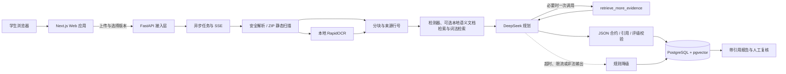

# 比赛交付

整理：2026-10-10。按用途合并原分散文档；各节保留原始条件和成文日期。当前运行、已验收范围与待办以[当前接力](../当前接力.md)和[任务清单](../任务清单.md)为准；历史测试数、套餐余额和待办不得当作今日状态。

## 来源：赛前验收清单

## CareerProof 赛前验收清单

2026-09-26 当前模型路线全面统一DeepSeek；视觉已完成两次合成真实回答、键盘生成/复核/刷新/附件跳转及390px布局。后端284项、前端19项、生产构建通过。视觉区域与语义的独立复核、鼠标全流程、完整AI文字报告组合仍待验证，不能按这一小例宣称全部多模态验收通过。见[统一能力矩阵](AI与数据边界.md)。

2026-09-26 MCP更新：官方SDK本机stdio三工具联验通过，专用十分钟报告范围授权、撤销与独立审计落地；不宣称商业客户端界面、公开OAuth或外部模型自主规划已验收。详见[受控MCP使用与验收](工具与接入.md)。

2026-09-25 最新复验：两轮证据规划已在真实 DeepSeek 合成材料上执行，第一轮补检索、第二轮停止均有记录；发现并修复重复片段优先和 FastAPI 复合要求过度评级。隔离端口完成合成材料上传、真实模型分析、报告持久化与读取；后端 235 项、前端 18 项测试、Ruff、前端生产构建通过。真实两轮浏览器点击与项目外语义评审仍待完成。详见[两轮验收](../archive/验收记录/DeepSeek两轮补检索验收-20260925.md)、[正式 API 复验](../archive/验收记录/DeepSeek正式API复验-20260925.md)和[独立复核任务单](评测与人工复核.md)。

2026-09-25 更新：公开源码合成案例已显式区分“个人作品／第三方参考”，四例真实 DeepSeek 输出均未将参考代码计入个人实践等级；浏览器完成参考 ZIP 上传到带引用报告的验收。对四例 6 条模型逐项解释及 16 处引用做了[内部语义核对](../archive/验收记录/公开源码AI语义内部核对-20260924.md)，并生成不预填答案的外部复核包。后端 226 项测试与 Ruff 通过。内部核对不能代替项目外真实评审者签署；11 个固定难例及更大检索集也仍按下方未完成项处理。

2026-09-23 新增本地多语言语义文档候选：固定同义检索 3/3、无关文档拒绝 1/1；模型文件有固定提交与 SHA-256，缺失时保留词法/规则报告。后端现为 215 项及 Ruff 通过；前端未改，沿用此前 16 项测试、TypeScript 和生产构建结果。该小样本只证明接线与基本边界，真实材料检索质量、浏览器完整报告和独立人工评测仍待复验。见[验收记录](../archive/验收记录/本地语义文档检索验收-20260923.md)。下一段记录的是加入语义检索之前的基线。

2026-09-23 候选版本记录：后端210项、前端16项测试、TypeScript、生产构建和Ruff通过，数据库结构未改变。真实报告主链路已加入不改变规则分数的混合候选检索；固定小型基线路径预期3/3、分数边界3/3通过，但当前仍不是语义embedding。学生端证据驱动职业推荐已完成真实浏览器与390px复验。产品启动只允许AI链路，规则只作为证据约束、推荐预筛和模型异常后的被动兜底。助手初审与页面中的本人采纳都不能替代独立人工语义复核，因此仍不进入正式录制。详见[混合检索验收](../archive/验收记录/混合检索验收-20260923.md)、[DeepSeek验收](../archive/验收记录/DeepSeek可信度验收-20260918.md)、[主链路浏览器记录](../archive/验收记录/浏览器主链路验收记录-20260918.md)与[职业推荐浏览器记录](../archive/验收记录/职业推荐浏览器验收-20260922.md)。

### 每次候选版本

- [x] `alembic upgrade head` 与 `alembic check` 通过。
- [x] 后端 `ruff check app evals`、`pytest` 通过。
- [x] 前端 TypeScript、Node 测试和生产构建通过。
- [x] 127.0.0.1 生产模式成功主链路通过，浏览器控制台无错误。
- [x] 桌面和 390px 移动视口无横向溢出，关键按钮可操作。
- [x] 职业推荐使用合成材料完成浏览器生成、证据展开和岗位跳转；岗位页沿用同一组材料，外部 AI 授权仍默认关闭。
- [ ] SSE 中断后自动轮询，失败任务可重试，服务重启后 pending 任务可被扫描器接手。
- [x] 证据引用的材料版本、文件、行号、片段和哈希一致；完整报告验证器与浏览器引用跳转通过。
- [x] 混合检索候选不改变规则分数；注释不作为候选；缓存与上下文版本已随检索算法更新。
- [x] 本地语义模型有固定提交和权重校验；四个固定合成小例通过；缺失模型自动保留词法/规则报告。
- [ ] 更大且独立标注的语义检索集、真实浏览器报告中的语义引用与模型缺失组合情形完成复验。
- [ ] 11 个难例保存真实模型原始输出与逐结论人工判断；编号合法不能替代内容支持。
- [ ] 项目外真实评审者独立填写并签署公开源码 4 例复核包；内部核对记录仅供定位问题。
- [ ] 空实现、矛盾材料、仅依赖、伪造声明、提示注入无关键过度结论；完整片段或局部限制可见。
- [x] 人工复核状态与备注刷新后仍存在，权限隔离由自动化测试覆盖。
- [ ] 固定评测集全部通过；若规则或模型版本变化，生成新的基线文件而不是覆盖历史解释。
- [x] 当前演示只使用合成数据；当前树与本地 Git 历史密钥特征扫描为 0，仓库未跟踪 `.env`、上传目录、Cookie、Token 或真实简历。

### 最终提交前

- [ ] 官方组别、截止时间、压缩包命名、文档模板、视频时长和线上地址要求已经逐条核验。
- [ ] 项目所有者已处理 PyMuPDF 许可并加入最终 LICENSE；第三方传递依赖许可证已归档。
- [x] GitHub 私有仓库 `hahaandxixi/careerproof` 已创建并持续推送；已核对默认分支为 `main`、仓库可见性为 private，当前本地与 `origin/main` 同步。正式评审访问权限仍待赛事要求确定。
- [ ] 另一位成员在干净环境按 README 完成安装、启动、主链路和停止复现。
- [ ] README、技术文档、演示视频、答辩材料和实际产品说法一致。
- [ ] 正式技术 PDF 不超过赛事页数限制，最终 MP4 满足时长、1080p、编码、大小和命名要求。
- [ ] 真实模型名称、作用、调用位置、失败降级、费用和评测结果有运行证据；未实现能力不写成已完成。
- [ ] 在线环境完成 HTTPS、强密钥、备份、限流、日志脱敏、数据删除/保留策略和授权流程。

## 来源：提交资料骨架

## CareerProof 比赛提交资料骨架

更新日期：2026-10-02。本文是长版内容底稿；技术 PDF 候选稿 v2 已于 2026-10-02 重制（9 页，`scripts/build_submission_pdf.py` 生成，内容对齐当日实测：后端 770 通过/20 跳过、前端 102 项测试、两轮受控规划、MCP 与补证闭环）。团队信息已按报名系统确认（见下）。比赛期间仓库保持私有，须按赛事要求提供评审访问。

### 封面待填

- 作品名称：职证 CareerProof
- 学校：广州软件学院
- 参赛组别：B组（普通本科院校；组别以报名系统 2026-10-02 确认信息为准，提交前再核对一次，选错组别将被取消资格）
- 团队名称：jz（报名系统团队编号 38419）
- 团队成员：江博、郑振南（队伍另余 1 个名额；成员联系电话与邮箱以报名系统为准，不写入仓库）
- 指导教师：杨斌
- 远程仓库：https://github.com/hahaandxixi/careerproof （私有；评审访问方式待赛事说明）
- 可选演示地址：____________

### 项目摘要

CareerProof 面向准备实习与校招的学生，把简历中的技能声明连接到可定位的项目原文，生成
带文件、行号、版本和内容哈希的实践证据等级。DeepSeek 在规则给出的证据上限内，按
“相关性—实质操作—完整任务”参与 1–3 级初评；系统同时保留规则降级、引用白名单和人工
复核，避免把静态代码、依赖声明或自述扩大成能力认证。

首个完整场景聚焦软件开发岗位；运维与 DBA 使用有限静态规则演示。当前结果描述材料支持
程度，不代表考试等级、本人贡献、代码已运行或录用概率。

### 用户问题与产品价值

学生常在简历中写“熟悉 FastAPI、PostgreSQL、pytest”，但招聘者和学生本人很难快速找到
支撑这些声明的代码。关键词匹配还会混淆依赖声明、空函数、局部实现和完整任务。

CareerProof 让用户看到：

1. 哪些岗位要求有原文证据；
2. 当前证据只能支持到哪个实践等级；
3. 哪些结论仍缺运行记录、测试结果或贡献说明；
4. 补充什么材料最可能提高证据等级；
5. AI、规则和人工复核各自作出了什么判断。

### 技术架构

前端采用 Next.js 15、React 19、TypeScript 和 Tailwind CSS；后端采用 FastAPI、SQLAlchemy、
PostgreSQL 与 pgvector。本地 OCR 支持扫描 PDF 与常见图片。后端作为账号、材料处理与 AI
接入层，比赛演示以浏览器中的上传、SSE、报告、引用和复核为主要呈现。

### AI 核心设计

#### 证据约束评级

- 检索层先用固定检测器，再用可选本地语义模型检索项目文档、有界词法检索代码与文本，固定材料版本并给出证据等级上限；补充候选不直接改变规则分数。
- DeepSeek 只分析有白名单证据的要求，逐项返回解释、缺口、建议、引用和三项评级判据。
- 三项判据必须顺序成立且各自引用当前要求内的合法证据，模型自报等级与判据不一致时拒绝。
- 模型不能改写原文件、行号、内容哈希和人工复核状态。

#### 受控 Function Calling

模型只能调用 `retrieve_more_evidence`，每份报告最多一次，仅查询当前上传索引，最多新增一条
证据。服务端校验要求编号、查询长度、作用域和返回数量，并在任务与报告页面展示工具名称、
查询、新增引用及固定范围。该能力是单工具受控工作流，不宣称通用 Agent 或 MCP 生态。

#### 多模态与隐私

RapidOCR 在本地把扫描 PDF 和图片转为可引用文本，保留页码、平均置信度与人工核对提示。
外部模型只接收岗位要求、规则结论和每项最多三段必要证据；姓名标签、手机号、邮箱和身份证号
按规则脱敏。没有证据时跳过外部调用；用户发起分析前必须主动同意发送范围。

### 已验收主链路

以下为历史专项验收记录；内部验收岗位已关闭，报告保留。当前普通操作请从 `/demo` 选择 CP01—CP09 对应材料，见 [演示测试指南](使用与启动.md)。不要把历史记录中的专项岗位当作当前公开职业。

1. 使用合成账号进入材料中心。
2. 上传 `demo/student-resume.txt` 与合成项目 ZIP，等待解析任务到 100%。
3. 选择“Python 受控补检索（合成验收）”岗位与固定材料版本，查看外发范围并授权。
4. SSE 从材料读取、检索、模型规划更新到报告完成。
5. DeepSeek 调用一次受控补检索，新增 `R1-E3`。
6. 报告给出 3/5，点击 `R1-E3` 回到 `create_item` 第 6–11 行。
7. 人工填写备注并采纳证据，刷新后状态、理由与时间仍然保留。
8. 在报告历史中找回同一份结果。

最新浏览器报告为 `f2ff6be5-a481-4e34-b38c-22011cd6c8d0`。桌面成功链路和
390 × 844 的上传页、岗位页、任务页、报告列表、详情页均通过，控制台没有捕获错误或警告。

### 评测与工程证据

| 项目 | 当前证据 |
| --- | --- |
| 后端 | 210 项测试、Ruff 通过；Alembic 迁移检查沿用未改数据库结构的候选版本结果 |
| 前端 | 11 项 Node 测试、TypeScript 和 Next.js 生产构建通过 |
| 固定 DeepSeek 难例 | 11 项；8 项有证据并获得正文，3 项无证据按生产策略跳过 |
| 结构与引用 | 8 份正文原始 JSON 均少一个括号；严格单括号修复后 8/8 通过结构、引用与词法边界校验 |
| PostgreSQL 定向复验 | 参数化 SELECT 为 2/5；保存与查询的完整任务不成立 |
| Function Calling 完整报告 | 自主补取 `R1-E3` 后为 3/5，工具范围与引用可见 |
| 浏览器最新报告 | 3.8 秒，输入 3,264、输出 513 Tokens；上传到复核与刷新找回通过 |
| OCR | 合成图片真实模型烟测命中预期文字；真实本地 API 上传预览通过 |
| 独立人工语义复核 | 待项目成员以外的评审者签署，不能以助手初审替代 |

所有评测数据均为公开合成材料。以上结果证明当前工程约束链路，不代表招聘准确率、真实简历
泛化能力或供应商长期稳定性。

### 创新点

1. 把“有关键词”拆成自述、相关线索、实质操作和完整任务，降低依赖声明与空实现带来的误判。
2. 把模型引用约束到保存的文件、行号、版本与哈希，用户可点击核对原文。
3. 让模型在证据上限内参与评级，同时保留规则降级与人工纠错，不把模型回答包装成认证。
4. 用一次白名单补检索展示模型如何主动寻找缺失上下文，并保留完整工具审计记录。
5. 将 OCR 文本继续放入同一证据链，不把识别结果直接当作能力或运行证明。

### 风险与限制

- 当前真实报告主链路使用检测器、可选本地多语言语义文档候选与BM25式词法候选；knowledge_chunks 语义搜索已升级为 MiniLM 384 维语义向量（模型缺失自动回退哈希引擎并在结果元数据标注），语义索引质量仍以 64 例冻结对照为准，不能外推真实检索泛化。
- 4/5、5/5 需要更强的运行、质量或独立验证证据，当前 AI 自动评级只开放到 3/5。
- 独立人工语义复核尚未完成；引用合法不等于解释一定被证据支持。
- 模型不可用的规则降级有自动测试和历史 API 证据，本候选版本尚未重跑完整浏览器故障链路。
- 在线部署为可选项；当前没有生产级 HTTPS、备份、删除流程和公网安全审计。
- 项目许可证尚未确定，PyMuPDF 的 AGPL/商业许可是远程发布前阻断项。

### 正式提交待补字段

- 是否补招第三名队员（当前 2/3 人，可选）；
- 赛事个人中心确认的截止时间、压缩包命名、PDF 模板和视频要求；
- 独立评审者签署的语义复核结果；
- 最终 LICENSE、完整第三方许可文本与原创声明签名；
- GitHub 私有仓库的评审访问方式；
- 不超过 30 页的正式 PDF 和 5–8 分钟 1080p MP4；
- 如选择在线演示，再补公网地址、评审账号和评审期运维方案。

## 来源：演示视频脚本骨架

## CareerProof 演示视频脚本

更新日期：2026-09-25。目标成片约 7 分 30 秒、1080p；最终时长和格式以赛事个人中心为准。
全程使用 `demo/` 合成数据，关闭通知，不展示 `.env`、API Key、控制台敏感配置或真实简历。

2026-09-26 可选视觉镜头：DeepSeek同一Key已完成合成截图理解，展示可见文字、估计区域和待核验项；需独立原图外发授权，不能把截图当部署认证或自动提级依据。浏览器键盘闭环已验，鼠标和独立区域/语义复核仍待完成。录制前可替换部分OCR时段，控制原时长，不增加新供应商或宣称OCR本身是视觉模型。

### 分镜与讲解

| 时间 | 画面 | 讲解要点 |
| --- | --- | --- |
| 0:00–0:25 | 标题与一句话定位 | “CareerProof 把简历技能声明连接到可点击的项目原文，让 AI 解释材料支持了什么、还缺什么。” |
| 0:25–0:55 | 用户痛点 | 依赖声明、函数名和简历自述容易被误当成能力证明；学生不知道下一步该补什么材料。 |
| 0:55–1:20 | 架构图 | 浏览器是主要呈现；后端负责解析、候选检索、DeepSeek 接入、引用校验与被动降级。 |
| 1:20–2:05 | 材料上传 | 演示学生上传合成简历与项目 ZIP，展示解析进度和固定版本；不展示真实简历。 |
| 2:05–2:50 | 选岗与隐私授权 | 选择 Python 岗位及材料版本，展开外发范围并主动同意；强调只发送有界必要片段。 |
| 2:50–3:30 | SSE 工作流 | 任务页展示检索、一次受控补检索、模型分析、引用校验和报告保存。 |
| 3:30–4:20 | AI 评级报告 | 展示逐项解释、3/5 实践证据等级和三项判据；等级描述材料，不是能力认证。 |
| 4:20–5:00 | 工具调用与引用 | 展开受控补检索记录，点击 `R1-E3` 核对原文件与行号；说明内部受控工具不等于通用 Agent；可另演示本机只读 MCP 授权、SDK 调用与撤销。 |
| 5:00–5:50 | AI 职业规划 | 在「职业推荐」比较软件、运营、数据方向，展示关键缺口与可执行补证任务；点击项目引用直达原始文件。 |
| 5:50–6:35 | 企业岗位拆解 | 企业端粘贴合成岗位原文，展示带原文定位的 AI 草稿，人工确认后才填入发布表单。 |
| 6:35–7:00 | 人工复核与 OCR | 展示已保存的复核记录和 OCR 页码/置信度；明确本人复核与独立评审不同。 |
| 7:00–7:30 | 故障、评测与边界 | 模型不可用时规则被动兜底；11 个固定难例如实标注失败；不把 OCR 称为视觉理解，不把匹配称为录用预测。 |

### 必须拍清楚的证据

1. 上传页明确显示演示文件名和解析 100%。
2. 授权区显示发送范围、脱敏与“不发送完整原文件”的说明。
3. 任务页出现模型规划、受控补检索、引用校验和报告保存阶段。
4. 报告页显示 `deepseek-flash`、Token、3/5、三个评级判据和待补证据。
5. `R1-E3` 展示真实文件路径、行号和六行代码，且能从解释跳转。
6. 人工复核刷新后保持；报告历史能找回同一结果。
7. 职业规划的引用打开原文件；企业草稿定位岗位原文且不会自动发布。
8. 结尾展示测试、浏览器验收和固定难例数字，同时保留“独立人工复核待完成”。

### 建议使用的演示结果

- 当前联网报告：`f2ff6be5-a481-4e34-b38c-22011cd6c8d0`。
- 当前任务：`db2bfd82-cadc-4153-8e23-e7a78aa34b46`。
- 合成简历：`demo/student-resume.txt`。
- 基础项目：`demo/evidence-api.zip`。
- Function Calling 源码：`demo/evidence-function-call/`；录制前按演示指南打包。
- 降级画面：使用已经保存且明确标注为历史合成故障的报告，不在正式录制时临时破坏当前配置。

### 录制前检查

- [ ] 确认赛事最终视频时长、编码、文件名和大小限制。
- [ ] 使用 1920 × 1080 画布，浏览器缩放 100%，系统通知与密码管理器提示关闭。
- [ ] `.env`、终端环境变量、请求头、数据库密码、Cookie 与 API Key 不进入画面。
- [ ] 预先打开联网报告、降级报告、架构图和评测表，减少现场等待与模型额度消耗。
- [ ] 朗读内容与当前实现一致，区分内部 Function Calling 与已验收的本机只读 MCP；不把 OCR 说成视觉理解。
- [ ] 不声称独立人工语义复核通过，除非任务单已经由真实评审者签署。
- [ ] 录制后从头检查声音、分辨率、敏感信息、页面报错和引用可读性。

## 来源：原创与AI辅助声明草案

## CareerProof 原创与 AI 辅助声明草案

更新日期：2026-09-19。正式提交前由全体成员核对并签署。

### 项目信息

- 作品名称：职证 CareerProof
- 学校：____________
- 参赛组别：____________
- 成员 1：____________
- 成员 2：____________
- 成员 3：____________
- 指导教师：____________

### 原创声明

本作品围绕“岗位要求—个人声明—项目原文证据—AI 初评—人工复核”的可追溯链路设计。
账户与权限、材料版本、异步任务、静态证据检索、实践证据等级、受控补检索、引用校验、
规则降级、人工复核和报告界面均为本项目针对比赛场景形成的实现。

仓库从 2026-09-17 的可运行基线开始保留真实 Git 提交记录。该日期以前的开发过程没有完整
Git 历史，因此不把首次提交伪装成从零开发过程。项目没有引入 DeepSeek 网页私有接口、
Cookie 转接或用户此前调研的网页反向代理源码。

### AI 辅助开发说明

开发过程中使用 AI 编程助手协助需求拆解、代码审阅、测试设计、文档整理与局部实现。
参赛成员负责确认需求、运行代码、检查差异、处理密钥与隐私、执行测试，并应能够解释最终
提交的全部代码逻辑。DeepSeek API 只在产品运行时对经过最小化和脱敏的合成或授权材料做
证据约束分析，不用于自动录用决策。

### 第三方组件

项目使用 Next.js、React、FastAPI、PostgreSQL、pgvector、RapidOCR、ONNX Runtime 等开源
组件。直接依赖及许可见根目录 `THIRD_PARTY_NOTICES.md`。最终许可证尚需处理 PyMuPDF 的
AGPL/商业双重许可，详见 `docs/发布许可决策.md`。

### 数据声明

仓库演示数据均为虚构合成材料，不对应真实个人或组织。真实简历、上传目录、`.env`、API
Key、Cookie、Token 和运行临时目录不进入版本控制。报告描述材料支持程度，不构成能力认证、
考试证书、录用概率或自动决策。

### 签署

我们确认以上陈述与最终提交版本一致，并愿意对作品原创性、第三方许可和数据合规负责。

成员签名：________________　________________　________________

日期：____________

## 来源：发布许可决策

## 发布许可决策

更新日期：2026-10-02。状态：**比赛期间 GitHub 仓库保持私有（防参赛材料被盗用，为团队主动选择而非阻断项）；赛后已确定开源，开源前完成下述许可证选择**。仓库根目录暂不添加 LICENSE。

项目所有者 2026-10-02 明确：私有是临时安排，赛后将开源。私有仓库仅用于保留远程提交历史；若赛事要求评审访问，须按官方说明单独授予指定评审者权限或提交可访问的代码包。不要把私有仓库链接误写为公开可访问。赛后公开前，仍须处理下述 PyMuPDF 许可选择与第三方依赖核查。

### 已确认事实

- 项目业务代码形成独立 Git 仓库，首次提交是 2026-09-17 的可运行基线，没有伪造更早历史。
- 已配置并推送 GitHub 私有仓库 `hahaandxixi/careerproof`；可见性已核验为 `PRIVATE`，默认分支为 `main`。
- 后端直接依赖 `PyMuPDF==1.26.4`；本地包元数据标明 AGPL-3.0 或 Artifex 商业许可。使用位置：`app/tools/document_parser.py` 的 PDF 文本提取与扫描页转位图（OCR 前置）。
- 若走替换路线，候选为 `pypdfium2`（Apache-2.0）：同一库可覆盖"文本提取 + 页面渲染"两个用途，避免 pypdf（仅文本）加 poppler（需外部二进制）的组合。
- 其余已登记的直接生产依赖使用 MIT、BSD、Apache、Unlicense 或 MIT-CMU 等许可。
- 本仓库没有复制 DeepSeek 网页反向代理项目代码，也不包含第三方网页 Cookie 或用户令牌。
- 2026-09-23 新增的本地语义模型 [paraphrase-multilingual-MiniLM-L12-v2](https://huggingface.co/sentence-transformers/paraphrase-multilingual-MiniLM-L12-v2) 模型卡标注 Apache-2.0；其 ONNX 权重不进入仓库，下载脚本固定提交与校验值。最终第三方清单需加入 FastEmbed 及其传递依赖。

### 可选方案

| 方案 | 适用目标 | 工作量与约束 |
| --- | --- | --- |
| AGPL-3.0-or-later | 赛后开源且希望防止他人闭源商用（传染性条款与本团队防盗用诉求一致） | 改动最少：加 LICENSE 即可；但日后若想闭源商业化须先换掉 PyMuPDF，部分企业使用者会规避 AGPL 代码 |
| 替换 PyMuPDF 后采用 MIT/Apache-2.0 | 希望最大化传播、被广泛复用或保留商业化自由 | 改 `document_parser.py` 文本提取与扫描页渲染两处（候选 pypdfium2，Apache-2.0），重跑文本 PDF、扫描 PDF、OCR、超时隔离与材料任务回归 |
| Artifex 商业许可 | 希望保留 PyMuPDF 且不采用 AGPL | 需要额外采购与法务确认，不适合作为默认学生竞赛方案 |

### 当前建议

比赛期间无需为此项做任何改动（私有仓库 + 评审授权已满足规则），不要提前添加 LICENSE。赛后再二选一：若开源目标以"展示作品、防止被闭源商用"为主，选 AGPL-3.0-or-later（零工作量，且传染性正好提供防白嫖保护）；若希望作品被广泛复用、保留商业化自由，先替换为 pypdfium2 再选 MIT 或 Apache-2.0。替换可与赛后的清理迭代一起做，不占用赛前时间。

### 选择记录

- [ ] 方案 A：AGPL-3.0-or-later
- [ ] 方案 B：替换 PyMuPDF 后采用宽松许可证
- [ ] 方案 C：取得商业许可

选择人：____________　日期：____________　理由：________________________________

选择后需要同步更新根目录 `LICENSE`、README、技术 PDF、第三方清单和远程仓库说明。
本文件用于工程决策记录，不构成法律意见。
