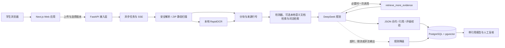

# CareerProof 比赛提交资料骨架

更新日期：2026-10-02。本文是长版内容底稿；已另生成 6 页 [技术 PDF 候选稿](../output/pdf/CareerProof-技术文档-提交候选稿.pdf)，包含本轮职业规划、岗位拆解与来源跳转。团队信息已按报名系统确认（见下）；候选 PDF 基于旧版能力描述，重制前不得直接提交。比赛期间仓库保持私有，须按赛事要求提供评审访问。

## 封面待填

- 作品名称：职证 CareerProof
- 学校：广州软件学院
- 参赛组别：B组（普通本科院校；组别以报名系统 2026-10-02 确认信息为准，提交前再核对一次，选错组别将被取消资格）
- 团队名称：jz（报名系统团队编号 38419）
- 团队成员：江博、郑振南（队伍另余 1 个名额；成员联系电话与邮箱以报名系统为准，不写入仓库）
- 指导教师：杨斌
- 远程仓库：https://github.com/hahaandxixi/careerproof （私有；评审访问方式待赛事说明）
- 可选演示地址：____________

## 项目摘要

CareerProof 面向准备实习与校招的学生，把简历中的技能声明连接到可定位的项目原文，生成
带文件、行号、版本和内容哈希的实践证据等级。DeepSeek 在规则给出的证据上限内，按
“相关性—实质操作—完整任务”参与 1–3 级初评；系统同时保留规则降级、引用白名单和人工
复核，避免把静态代码、依赖声明或自述扩大成能力认证。

首个完整场景聚焦软件开发岗位；运维与 DBA 使用有限静态规则演示。当前结果描述材料支持
程度，不代表考试等级、本人贡献、代码已运行或录用概率。

## 用户问题与产品价值

学生常在简历中写“熟悉 FastAPI、PostgreSQL、pytest”，但招聘者和学生本人很难快速找到
支撑这些声明的代码。关键词匹配还会混淆依赖声明、空函数、局部实现和完整任务。

CareerProof 让用户看到：

1. 哪些岗位要求有原文证据；
2. 当前证据只能支持到哪个实践等级；
3. 哪些结论仍缺运行记录、测试结果或贡献说明；
4. 补充什么材料最可能提高证据等级；
5. AI、规则和人工复核各自作出了什么判断。

## 技术架构

前端采用 Next.js 15、React 19、TypeScript 和 Tailwind CSS；后端采用 FastAPI、SQLAlchemy、
PostgreSQL 与 pgvector。本地 OCR 支持扫描 PDF 与常见图片。后端作为账号、材料处理与 AI
接入层，比赛演示以浏览器中的上传、SSE、报告、引用和复核为主要呈现。

## AI 核心设计

### 证据约束评级

- 检索层先用固定检测器，再用可选本地语义模型检索项目文档、有界词法检索代码与文本，固定材料版本并给出证据等级上限；补充候选不直接改变规则分数。
- DeepSeek 只分析有白名单证据的要求，逐项返回解释、缺口、建议、引用和三项评级判据。
- 三项判据必须顺序成立且各自引用当前要求内的合法证据，模型自报等级与判据不一致时拒绝。
- 模型不能改写原文件、行号、内容哈希和人工复核状态。

### 受控 Function Calling

模型只能调用 `retrieve_more_evidence`，每份报告最多一次，仅查询当前上传索引，最多新增一条
证据。服务端校验要求编号、查询长度、作用域和返回数量，并在任务与报告页面展示工具名称、
查询、新增引用及固定范围。该能力是单工具受控工作流，不宣称通用 Agent 或 MCP 生态。

### 多模态与隐私

RapidOCR 在本地把扫描 PDF 和图片转为可引用文本，保留页码、平均置信度与人工核对提示。
外部模型只接收岗位要求、规则结论和每项最多三段必要证据；姓名标签、手机号、邮箱和身份证号
按规则脱敏。没有证据时跳过外部调用；用户发起分析前必须主动同意发送范围。

## 已验收主链路

以下为历史专项验收记录；内部验收岗位已关闭，报告保留。当前普通操作请从 `/demo` 选择 CP01—CP09 对应材料，见 [演示测试指南](演示测试指南.md)。不要把历史记录中的专项岗位当作当前公开职业。

1. 使用合成账号进入材料中心。
2. 上传 `demo/student-resume.txt` 与合成项目 ZIP，等待解析任务到 100%。
3. 选择“Python 受控补检索（合成验收）”岗位与固定材料版本，查看外发范围并授权。
4. SSE 从材料读取、检索、模型规划更新到报告完成。
5. DeepSeek 调用一次受控补检索，新增 `R1-E3`。
6. 报告给出 3/5，点击 `R1-E3` 回到 `create_item` 第 6–11 行。
7. 人工填写备注并采纳证据，刷新后状态、理由与时间仍然保留。
8. 在报告历史中找回同一份结果。

最新浏览器报告为 `f2ff6be5-a481-4e34-b38c-22011cd6c8d0`。桌面成功链路和
390 × 844 的上传页、岗位页、任务页、报告列表、详情页均通过，控制台没有捕获错误或警告。

## 评测与工程证据

| 项目 | 当前证据 |
| --- | --- |
| 后端 | 210 项测试、Ruff 通过；Alembic 迁移检查沿用未改数据库结构的候选版本结果 |
| 前端 | 11 项 Node 测试、TypeScript 和 Next.js 生产构建通过 |
| 固定 DeepSeek 难例 | 11 项；8 项有证据并获得正文，3 项无证据按生产策略跳过 |
| 结构与引用 | 8 份正文原始 JSON 均少一个括号；严格单括号修复后 8/8 通过结构、引用与词法边界校验 |
| PostgreSQL 定向复验 | 参数化 SELECT 为 2/5；保存与查询的完整任务不成立 |
| Function Calling 完整报告 | 自主补取 `R1-E3` 后为 3/5，工具范围与引用可见 |
| 浏览器最新报告 | 3.8 秒，输入 3,264、输出 513 Tokens；上传到复核与刷新找回通过 |
| OCR | 合成图片真实模型烟测命中预期文字；真实本地 API 上传预览通过 |
| 独立人工语义复核 | 待项目成员以外的评审者签署，不能以助手初审替代 |

所有评测数据均为公开合成材料。以上结果证明当前工程约束链路，不代表招聘准确率、真实简历
泛化能力或供应商长期稳定性。

## 创新点

1. 把“有关键词”拆成自述、相关线索、实质操作和完整任务，降低依赖声明与空实现带来的误判。
2. 把模型引用约束到保存的文件、行号、版本与哈希，用户可点击核对原文。
3. 让模型在证据上限内参与评级，同时保留规则降级与人工纠错，不把模型回答包装成认证。
4. 用一次白名单补检索展示模型如何主动寻找缺失上下文，并保留完整工具审计记录。
5. 将 OCR 文本继续放入同一证据链，不把识别结果直接当作能力或运行证明。

## 风险与限制

- 当前真实报告主链路使用检测器、可选本地多语言语义文档候选与BM25式词法候选；数据库中的本地哈希向量不是语义 embedding。四个语义小例只证明接线，不能外推真实检索质量。
- 4/5、5/5 需要更强的运行、质量或独立验证证据，当前 AI 自动评级只开放到 3/5。
- 独立人工语义复核尚未完成；引用合法不等于解释一定被证据支持。
- 模型不可用的规则降级有自动测试和历史 API 证据，本候选版本尚未重跑完整浏览器故障链路。
- 在线部署为可选项；当前没有生产级 HTTPS、备份、删除流程和公网安全审计。
- 项目许可证尚未确定，PyMuPDF 的 AGPL/商业许可是远程发布前阻断项。

## 正式提交待补字段

- 是否补招第三名队员（当前 2/3 人，可选）；
- 赛事个人中心确认的截止时间、压缩包命名、PDF 模板和视频要求；
- 独立评审者签署的语义复核结果；
- 最终 LICENSE、完整第三方许可文本与原创声明签名；
- GitHub 私有仓库的评审访问方式；
- 不超过 30 页的正式 PDF 和 5–8 分钟 1080p MP4；
- 如选择在线演示，再补公网地址、评审账号和评审期运维方案。
