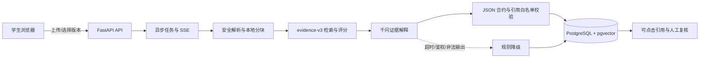

# CareerProof 比赛提交资料骨架

更新日期：2026-09-12。官方模板、组别和最终格式仍需按赛事原文填写。

## 项目摘要

- 项目名：职证 CareerProof
- 一句话：把简历技能声明连接到可定位的项目证据，让千问在引用约束内解释“材料支持了什么、还缺什么”。
- 首个完整场景：软件开发实习岗位。
- 已验收能力：账户权限、岗位、材料版本、异步解析、SSE、本地证据检索、规则评分、千问逐项解释、引用校验、自动降级、人工复核和历史报告。

## 问题与用户

学生简历中的技能词常缺少可快速核对的出处。普通关键词匹配也难以区分依赖声明、代码实现和简历自述。CareerProof 面向准备实习或校招的学生，把结论固定到具体材料版本、文件、行号和内容哈希，并允许人工纠错。

## 技术架构

前端采用 Next.js 15、React 19、TypeScript 和 Tailwind CSS；后端采用 FastAPI、SQLAlchemy、PostgreSQL 与 pgvector。外部模型最多接收每项三条候选证据，不接收姓名、联系方式、完整简历或完整项目文件。

## 演示主链路

1. 打开含 Python、FastAPI、PostgreSQL、pytest、Redis 五项要求的合成岗位。
2. 上传 `demo/student-resume.txt` 和 `demo/evidence-api.zip`，查看 SSE 解析状态与版本。
3. 发起匹配，任务页展示材料核对、证据检索、规则评分、千问分析、引用校验和报告保存。
4. 在报告点击 `R2-E1` 等引用，核对 FastAPI 路由；展示 PostgreSQL 的部分支持和 Redis 的信息缺口。
5. 人工采纳一条证据并刷新，证明复核持久化。
6. 使用错误测试凭据演示模型不可用，任务仍完成并明确显示规则降级。

## 效果证据

- 后端 80 项测试、ruff、数据库迁移检查通过；前端 11 项测试、类型检查、生产构建通过。
- 规则基线 `evidence-v3` 为 7/7，引用定位 7/7。
- 千问合成基线 5 项：要求覆盖率、引用精度、有证据项引用率、缺口完整率、边界合规率均为 100%，越权引用 0；710 输入、677 输出 tokens，总延迟 15,608 ms。
- 生产浏览器链路已验证联网报告与鉴权失败降级报告，控制台无错误；人工复核刷新后保留。

测试集规模较小且全部为合成材料，这些数字只证明当前约束链路，不代表招聘准确率。

## 风险与边界

分数表示材料支持度，不表示能力认证或录用概率。依赖声明只作为低强度证据；不支持的技能不计入分母；没有找到证据不表示用户没有能力。当前未完成用户自助删除、企业投递授权、生产级审计与公开网络安全加固。

## 待官方信息确认后填写

- 参赛组别、团队成员及高校信息
- 官方评分维度原文与逐项映射
- 在线演示和代码仓库地址
- 技术文档、视频、封面、命名和许可要求
- 指导提交与最终提交的官方时间
